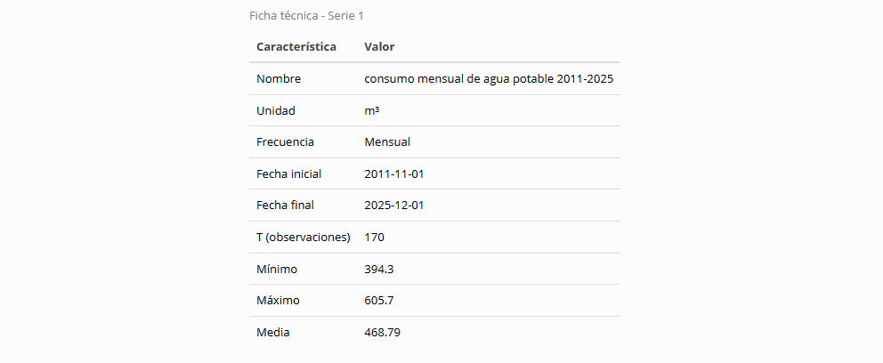
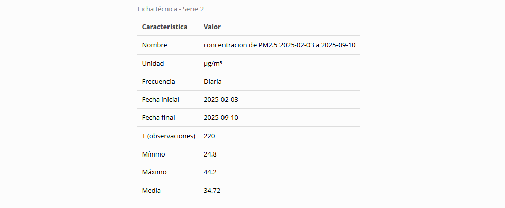
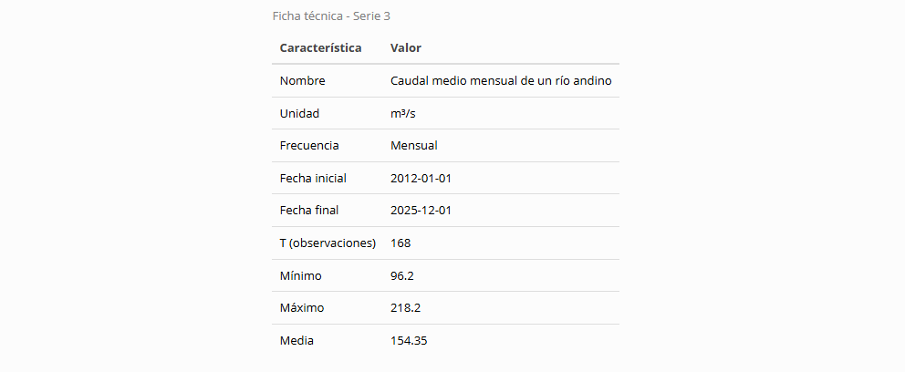
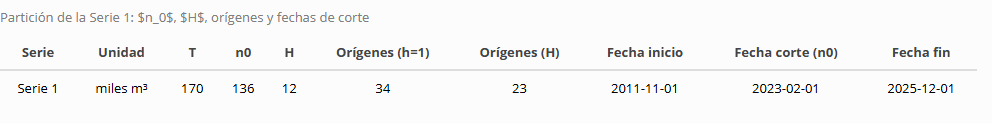

```{r setup, include=FALSE}
knitr::opts_chunk$set(echo = TRUE, message = FALSE, warning = FALSE)
library(dplyr)
library(tidyr)
library(purrr)
library(tibble)
library(ggplot2)
library(kableExtra)
```

\newpage

# Punto 2

```{r, include=FALSE}
# lectura de series

source("../R/00-lectura.R")

serie_1 <- leer_serie("../datos/STJNKV-serie-1.csv", "CORPALMAS acueducto", "miles m³")

serie_2 <- leer_serie("../datos/STJNKV-serie-2.csv", "estación de monitoreo del centro de Villa Clara", "µg/m³")

serie_3 <- leer_serie("../datos/STJNKV-serie-3.csv", "CORPALMAS acueducto", "m³/s")


```


## A

### ficha serie 1


{width="100%"}

### ficha serie 2

{width="100%"}


### ficha serie 3

{width="100%"}

## B

**serie 1**


**pregunta serie 1** ¿El consumo mensual de agua potable en miles de m³ de la ciudad Villa Clara superara la capacidad de su acueducto de potavilizar 650 mil m³ al mes para planificar una ampliacion en un horizonte de 18 a 24 meses?


**serie 2**

**pregunta serie 2**

En la estación de monitoreo de Villa Clara se mide diariamente la concentración de PM2.5 para gestionar la calidad del aire. Con el objetivo de decidir si la alcaldía debe declarar alerta ambiental y restringir el transporte de carga para el día siguiente, ¿Superará la concentración promedio diaria de PM2.5 los 37 µg/m³ el día de mañana?

**serie 3**


Caudal medio mensual, en m³/s, del río Sinuoso en la bocatoma del acueducto, medido por la estación limnigráfica de la corporación. La concesión permite captar el volumen completo mientras el caudal se mantenga por encima de 110 m³/s; por debajo de ese valor la corporación ordena reducir la captación a la mitad, y la empresa debe llenar con anticipación los tanques de reserva, lo que cuesta 150 millones de pesos por mes. Interesa a la corporación, a la empresa de acueducto y a los usuarios de la cuenca aguas abajo. La pregunta de la empresa de acueducto: ¿en cuáles de los próximos doce meses conviene preparar los tanques de reserva?

**pregunta serie 3**

¿en que mes del proximo año segun un diagnostico del caudal del rio sinuoso medido en m³/s mensualmente se reducira por debajo de 110 m³/s en un horizonte de 12 meses para llenar preparar el presupuesto de llenado de tanques con anticipacion y el tiempo necesario de mantenerlos llenos?


## C


{width="100%"}

# Punto 3


# Punto 4


## b

**serie 1**

se propone una diferencia $\nabla^2 log(yt)}$ y una transformacion $log(y_t)$ para los datos y el polinomio quedaria $1-B - B^{12} +B^{13}$


