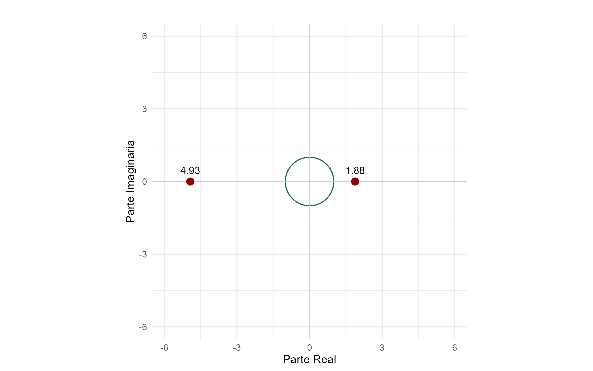
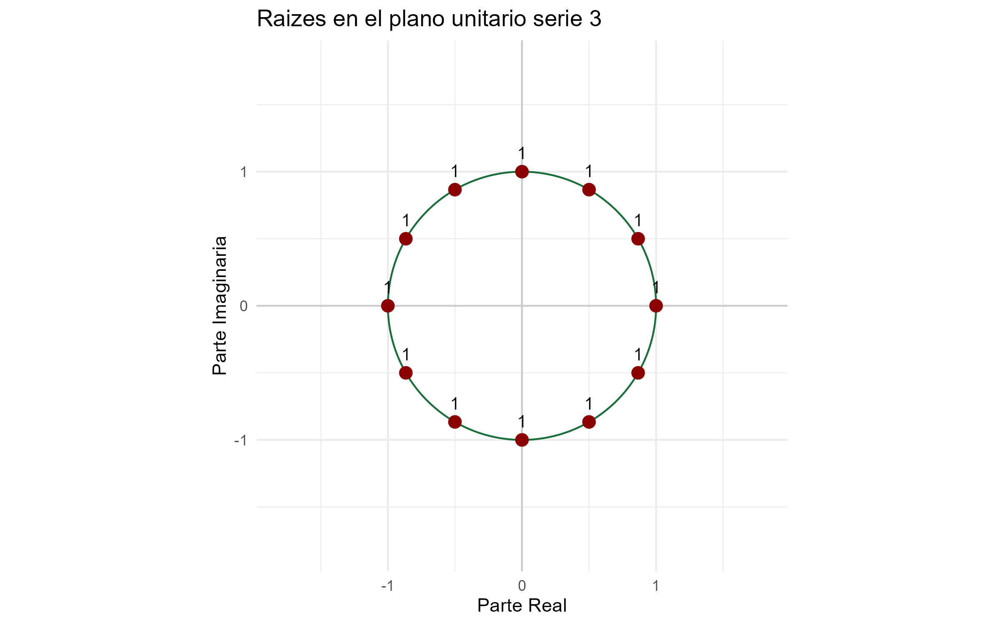
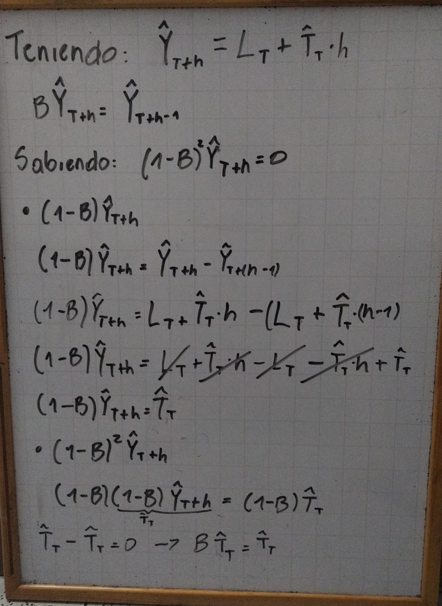
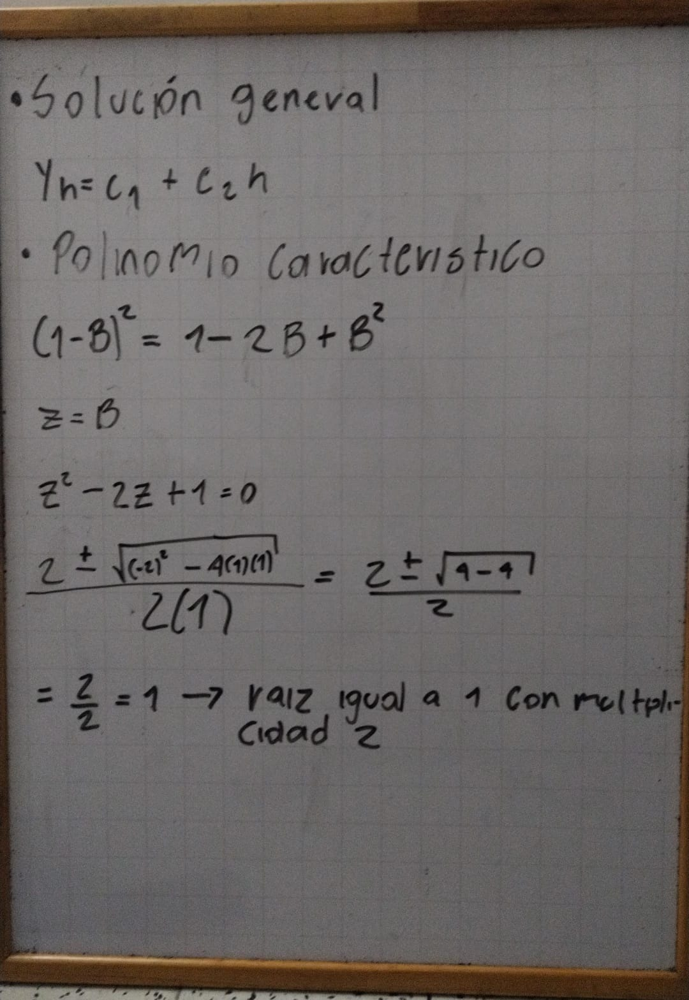
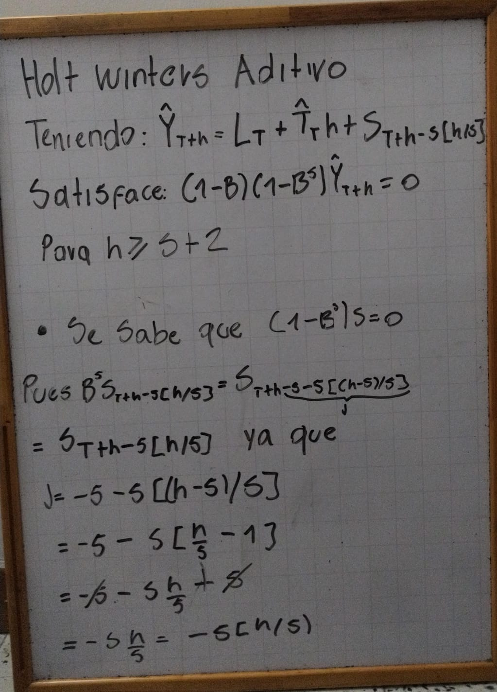
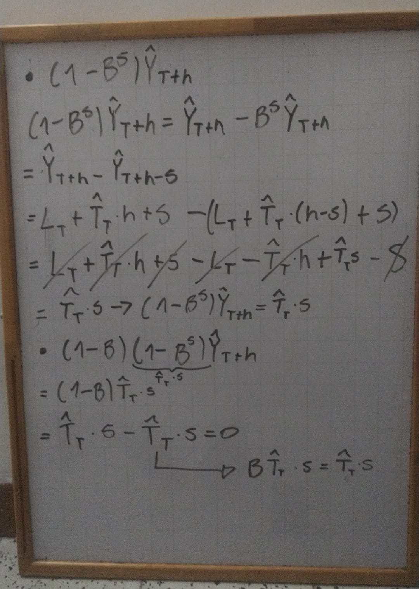
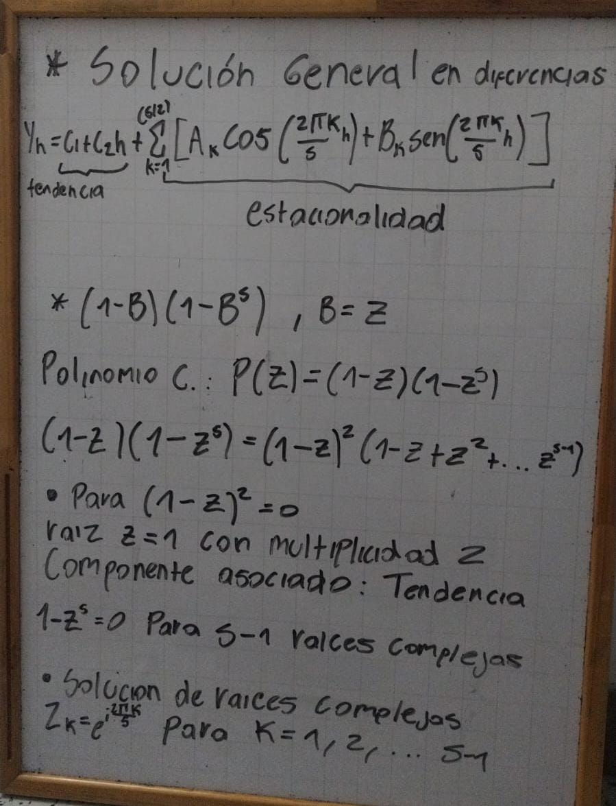

```{r setup, include=FALSE}
knitr::opts_chunk$set(echo = TRUE, message = FALSE, warning = FALSE)
library(dplyr)
library(tidyr)
library(purrr)
library(tibble)
library(ggplot2)
library(kableExtra)
```

\newpage

```{r, include=FALSE}

source("../R/00-lectura.R")
source("../R/01-Graficos.R")
source("../R/02-operadores.R")
source("../R/03-dependencia.R")
source("../R/04-metodos.R")
source("../R/05-evaluacion.R")


```

# 1

# Punto 2

```{r, include=FALSE}
# lectura de series


serie_1 <- leer_serie("../datos/STJNKV-serie-1.csv", "CORPALMAS acueducto", "miles m³")

serie_2 <- leer_serie("../datos/STJNKV-serie-2.csv", "estación de monitoreo del centro de Villa Clara", "µg/m³")

serie_3 <- leer_serie("../datos/STJNKV-serie-3.csv", "CORPALMAS acueducto", "m³/s")


```

```{r, include=FALSE}

# funciones de tablas


crear_ficha <- function(serie, nombre = "Serie 1", unidad = attr(serie, "unidad")) {
  
  freq <- attr(serie, "frecuencia")
  if (is.null(freq)) freq <- 1
  
  frecuencia_label <- switch(as.character(freq),
                             "12"  = "Mensual",
                             "4"   = "Trimestral",
                             "1"   = "Anual",
                             "52"  = "Semanal",
                             "365" = "Diaria",
                             as.character(freq))
  
  fecha_ini <- as.character(min(serie$fecha, na.rm = TRUE))
  fecha_fin <- as.character(max(serie$fecha, na.rm = TRUE))
  val       <- serie$y
  
  tibble(
    Característica = c("Nombre", "Unidad", "Frecuencia",
                       "Fecha inicial", "Fecha final",
                       "T (observaciones)", "Mínimo",
                       "Máximo", "Media"),
    Valor = c(as.character(nombre),
              as.character(if (is.null(unidad)) "sin unidad" else unidad),
              frecuencia_label,
              fecha_ini,
              fecha_fin,
              as.character(length(val)),
              as.character(round(min(val, na.rm = TRUE), 2)),
              as.character(round(max(val, na.rm = TRUE), 2)),
              as.character(round(mean(val, na.rm = TRUE), 2)))
  )
}


tabla_transformaciones <- function(y, transformaciones) {
  purrr::imap_dfr(transformaciones, function(f, nombre) {
    
    y_t <- f(y)   # serie transformada
    
    # correlograma() necesita un objeto con $y -> lo envolvemos en lista
    r1_t <- correlograma(list(y = y_t), m = 1)$acf[1]
    
    tibble::tibble(
      Transformacion = nombre,
      Media    = mean(y_t),
      Varianza = var(y_t),
      r1       = r1_t
    )
  })
}


```

## A

### Item A

#### ficha serie 1

<!-- {width="100%"} -->

```{r, echo=FALSE}

ficha_st1 <- crear_ficha(serie_1, "consumo mensual de agua potable 2011-2025", " miles de m³")

tabla_ficha1 <- kable(ficha_st1, booktabs = TRUE, align = c("l", "l"),
      caption = "Ficha técnica - Serie 1") |>
  kable_styling(latex_options = c("hold_position"),
                full_width = FALSE)
tabla_ficha1

```

#### ficha serie 2

<!-- {width="100%"} -->

```{r, echo=FALSE}

ficha_st2 <- crear_ficha(serie_2, "concentracion de PM2.5  2025-02-03 a 2025-09-10")

tabla_ficha2 <- kable(ficha_st2, booktabs = TRUE, align = c("l", "l"),
      caption = "Ficha técnica - Serie 2") |>
  kable_styling(latex_options = c("hold_position"),
                full_width = FALSE)


tabla_ficha2

```

#### ficha serie 3

<!-- {width="100%"} -->

```{r, echo=FALSE}

ficha_st3 <- crear_ficha(serie_3, "Caudal medio mensual de un río andino", "m³/s")

tabla_ficha3 <- kable(ficha_st3, booktabs = TRUE, align = c("l", "l"),
      caption = "Ficha técnica - Serie 3") |>
  kable_styling(latex_options = c("hold_position"),
                full_width = FALSE)

tabla_ficha3

```

## B

**serie 1**

**pregunta serie 1** ¿El consumo mensual de agua potable en miles de m³ de la ciudad Villa Clara superara la capacidad de su acueducto de potavilizar 650 mil m³ al mes para planificar una ampliacion en un horizonte de 12 meses?

**serie 2**

**pregunta serie 2**

En la estación de monitoreo de Villa Clara se mide diariamente la concentración de PM2.5 para gestionar la calidad del aire. Con el objetivo de decidir si la alcaldía debe declarar alerta ambiental y restringir el transporte de carga para el día siguiente, ¿Superará la concentración promedio diaria de PM2.5 los 37 µg/m³ el día de mañana?

**serie 3**

Caudal medio mensual, en m³/s, del río Sinuoso en la bocatoma del acueducto, medido por la estación limnigráfica de la corporación. La concesión permite captar el volumen completo mientras el caudal se mantenga por encima de 110 m³/s; por debajo de ese valor la corporación ordena reducir la captación a la mitad, y la empresa debe llenar con anticipación los tanques de reserva, lo que cuesta 150 millones de pesos por mes. Interesa a la corporación, a la empresa de acueducto y a los usuarios de la cuenca aguas abajo. La pregunta de la empresa de acueducto: ¿en cuáles de los próximos doce meses conviene preparar los tanques de reserva?

**pregunta serie 3**

¿en que mes del proximo año segun un diagnostico del caudal del rio sinuoso medido en m³/s mensualmente se reducira por debajo de 110 m³/s en un horizonte de 12 meses para llenar preparar el presupuesto de llenado de tanques con anticipacion y el tiempo necesario de mantenerlos llenos?

## C

```{r, include=FALSE}
#tablas para cada serie

T_1 <- nrow(serie_1)
frecuencia_1 <- attr(serie_1, "frecuencia")
unidad_1     <- attr(serie_1, "unidad")
fuente_1     <- attr(serie_1, "fuente")

# Regla de partición (ajustar según lo pedido en el enunciado)
n0_1 <- floor(0.8 * T_1)          # 80% entrenamiento
H_1  <- 18              # horizonte en la frecuencia de la serie

origenes_h1_1 <- T_1 - n0_1
origenes_H_1  <- T_1 - n0_1 - H_1 + 1

# Fechas que delimitan cada tramo
fecha_inicio_1 <- serie_1$fecha[1]
fecha_corte_1  <- serie_1$fecha[n0_1]
fecha_fin_1    <- serie_1$fecha[T_1]

tabla_serie1 <- tibble(
  Serie              = "Serie 1",
  Unidad             = unidad_1,
  `T`                = T_1,
  n0                 = n0_1,
  H                  = H_1,
  `Orígenes (h=1)`   = origenes_h1_1,
  `Orígenes (H)`     = origenes_H_1,
  `Fecha inicio`     = format(fecha_inicio_1, "%Y-%m-%d"),
  `Fecha corte (n0)` = format(fecha_corte_1, "%Y-%m-%d"),
  `Fecha fin`        = format(fecha_fin_1, "%Y-%m-%d")
)


tabla_Rs1 <- kable(tabla_serie1, booktabs = TRUE, align = "c",
      caption = "Partición de la Serie 1: $n_0$, $H$, orígenes y fechas de corte") |>
  kable_styling(latex_options = c("hold_position", "scale_down")) |>
  row_spec(nrow(tabla_serie1), extra_latex_after = "\\bottomrule")

# tabla 2

T_2 <- nrow(serie_2)
frecuencia_2 <- attr(serie_2, "frecuencia")
unidad_2     <- attr(serie_2, "unidad")
fuente_2     <- attr(serie_2, "fuente")

# Regla de partición (ajustar según lo pedido en el enunciado)
n0_2 <- floor(0.8 * T_2)          # 80% entrenamiento
H_2  <- 7              # horizonte en la frecuencia de la serie

origenes_h1_2 <- T_2 - n0_2
origenes_H_2  <- T_2 - n0_2 - H_2 + 1

# Fechas que delimitan cada tramo
fecha_inicio_2 <- serie_2$fecha[1]
fecha_corte_2  <- serie_2$fecha[n0_2]
fecha_fin_2    <- serie_2$fecha[T_2]

tabla_serie2 <- tibble(
  Serie              = "Serie 2",
  Unidad             = unidad_2,
  `T`                = T_2,
  n0                 = n0_2,
  H                  = H_2,
  `Orígenes (h=1)`   = origenes_h1_2,
  `Orígenes (H)`     = origenes_H_2,
  `Fecha inicio`     = format(fecha_inicio_2, "%Y-%m-%d"),
  `Fecha corte (n0)` = format(fecha_corte_2, "%Y-%m-%d"),
  `Fecha fin`        = format(fecha_fin_2, "%Y-%m-%d")
)


tabla_Rs2 <- kable(tabla_serie2, booktabs = TRUE, align = "c",
                   caption = "Partición de la Serie 2: $n_0$, $H$, orígenes y fechas de corte") |>
  kable_styling(latex_options = c("hold_position", "scale_down")) |>
  row_spec(nrow(tabla_serie2), extra_latex_after = "\\bottomrule")


# tabla 3

T_3 <- nrow(serie_3)
frecuencia_3 <- attr(serie_3, "frecuencia")
unidad_3     <- attr(serie_3, "unidad")
fuente_3     <- attr(serie_3, "fuente")

# Regla de partición (ajustar según lo pedido en el enunciado)
n0_3 <- floor(0.8 * T_3)          
H_3  <- frecuencia_3              

origenes_h1_3 <- T_3 - n0_3
origenes_H_3  <- T_3 - n0_3 - H_3 + 1

# Fechas que delimitan cada tramo
fecha_inicio_3 <- serie_3$fecha[1]
fecha_corte_3  <- serie_3$fecha[n0_3]
fecha_fin_3    <- serie_3$fecha[T_3]

tabla_serie3 <- tibble(
  Serie              = "Serie 3",
  Unidad             = unidad_3,
  `T`                = T_3,
  n0                 = n0_3,
  H                  = H_3,
  `Orígenes (h=1)`   = origenes_h1_3,
  `Orígenes (H)`     = origenes_H_3,
  `Fecha inicio`     = format(fecha_inicio_3, "%Y-%m-%d"),
  `Fecha corte (n0)` = format(fecha_corte_3, "%Y-%m-%d"),
  `Fecha fin`        = format(fecha_fin_3, "%Y-%m-%d")
)


tabla_Rs3 <- kable(tabla_serie3, booktabs = TRUE, align = "c",
                   caption = "Partición de la Serie 3: $n_0$, $H$, orígenes y fechas de corte") |>
  kable_styling(latex_options = c("hold_position", "scale_down")) |>
  row_spec(nrow(tabla_serie3), extra_latex_after = "\\bottomrule")

```

```{r, echo=FALSE}
# tabla entera

# 1. Combinar los tres data frames verticalmente en orden
tabla_completa <- bind_rows(tabla_serie1, tabla_serie2, tabla_serie3)

# 2. Obtener el número de filas de cada una para definir las secciones
n1 <- nrow(tabla_serie1)
n2 <- nrow(tabla_serie2)
n3 <- nrow(tabla_serie3)

# 3. Crear la tabla unificada con subcabeceras
tabla_Rs_total <- kable(
  tabla_completa, 
  booktabs = TRUE, 
  align = "c",
  caption = "Partición de las Series: $n_0$, $H$, orígenes y fechas de corte"
) |>
  kable_styling(latex_options = c("hold_position", "scale_down"), font_size = 8) |>
  pack_rows("Serie 1", 1, n1) |>
  pack_rows("Serie 2", n1 + 1, n1 + n2) |>
  pack_rows("Serie 3", n1 + n2 + 1, n1 + n2 + n3)

# 4. Presentar en el documento .qmd
tabla_Rs_total

```

```{r, include=FALSE}

# remove para no gastar tanta memoria
remove(T_1, frecuencia_1, unidad_1, fuente_1, n0_1, H_1, origenes_h1_1, origenes_H_1, 
       fecha_inicio_1, fecha_corte_1, fecha_fin_1, tabla_serie1, tabla_Rs1)

remove(T_2, frecuencia_2, unidad_2, fuente_2, n0_2, H_2, origenes_h1_2, origenes_H_2, 
       fecha_inicio_2, fecha_corte_2, fecha_fin_2, tabla_serie2, tabla_Rs2)

remove(T_3, frecuencia_3, unidad_3, fuente_3, n0_3, H_3, origenes_h1_3, origenes_H_3, 
       fecha_inicio_3, fecha_corte_3, fecha_fin_3, tabla_serie3, tabla_Rs3)

```

<!-- {width="100%"} -->

<!-- {width="100%"} -->

<!-- {width="100%"} -->

# Punto 3

## Item a

### Serie 1


Figura 1: Consumo mensual de agua potable. El consumo de agua sube con los años: empezó cerca de 400 miles de m³ en 2012 y llegó a cerca de 605 miles de m³ a finales de 2025. Pero no sube igual todo el tiempo. Hasta 2019 sube despacio, y desde 2020 sube mucho más rápido. No se ve con claridad ningún otro patrón, como subidas y bajadas que se repitan cada año.


Figura 2: ACF y PACF de la serie 1. En el gráfico de la ACF, la relación entre los rezagos y los anteriores es muy alta (cerca de 1 al inicio) y baja muy despacio al aumentar los rezagos. Esto confirma que la serie tiene una tendencia. En la PACF solo el primer rezago es significativo, con un valor cercano a 1. Los demás quedan dentro de las bandas, cerca de cero, y se comportan como ruido. Esto quiere decir que, una vez que se tiene en cuenta el rezago anterior, los rezagos más lejanos casi no aportan información nueva.


Figura 3: Se escogieron los rezagos 1, 12 y 24. El rezago 1 compara cada mes con el mes anterior. Los rezagos 12 y 24 comparan cada mes con el mismo mes de uno y de dos años atrás, y sirven para ver si el consumo se repite cada año. En los tres gráficos los puntos forman una línea que sube, lo que significa que un mes con consumo alto viene después de meses con consumo alto. En el rezago 1 los puntos quedan muy pegados a la línea, y en los rezagos 12 y 24 se van abriendo un poco. Esto es coherente con la tendencia de la serie.

### Serie 2


Figura 4: La concentración sube y baja todos los días, pero siempre alrededor de un mismo nivel, cerca de 35 µg/m³. No se ve que con el paso de los meses vaya subiendo o bajando, así que no hay tendencia. Los valores casi siempre están entre 25 y 45 µg/m³, y esa variación se mantiene. Tampoco se ve un patrón que se repita con claridad, como una semana más contaminada que otra.


Figura 5: En la ACF, los rezagos 1 y 2 son los únicos claramente altos: el primero es cerca de 0,6 y el segundo cerca de 0,2. Es decir, un día se parece al día anterior y, un poco menos, al de dos días atrás. Después la gráfica pasa a valores negativos pequeños y vuelve a subir un poco, como una onda suave, pero casi todos esos valores quedan dentro de las bandas, así que pueden ser solo azar.En la PACF solo los rezagos 1 y 2 son significativos: el 1 es positivo (cerca de 0,6) y el 2 es negativo (cerca de −0,25). Los demás quedan dentro de las bandas. Esto quiere decir que, para entender el valor de hoy, bastan los dos días anteriores.


Figura 6: Gráfico de rezagos de la serie 2. Se escogieron los rezagos 1 y 2, porque son los únicos que se destacan en los gráficos anteriores. El rezago 1 compara cada día con el día anterior, y el rezago 2 lo compara con el de dos días atrás. En el rezago 1 los puntos suben en una línea con bastante dispersión: si ayer hubo mucha contaminación, hoy suele haber bastante también, aunque no siempre. En el rezago 2 la línea casi no se inclina y los puntos quedan muy dispersos, así que anteayer dice poco sobre hoy

### Serie 3


Figura 7: El caudal sube y baja de forma muy regular, siempre alrededor de un mismo nivel, cerca de 155 m³/s. No se ve que con los años el río vaya llevando más o menos agua, así que no hay tendencia. Lo que sí se ve con claridad es un patrón que se repite: cada año aparecen dos épocas de caudal alto y dos de caudal bajo. Los valores más bajos rondan los 100 m³/s y los más altos llegan cerca de 200 m³/s.


Figura 8: En la ACF se ve una onda que sube y baja de forma muy regular y no se apaga con los rezagos. Los valores son positivos y altos en los rezagos 6, 12, 18 y 24 (cerca de 0,8), y negativos y de tamaño parecido en los rezagos 3, 9, 15 y 21 (cerca de −0,8). Esto quiere decir que un mes se parece mucho al de 6 meses atrás y al de 12, y es casi lo contrario del de 3 o 9 meses atrás. Es la huella de un ciclo que se repite, y casi todos esos picos quedan fuera de las bandas. En la PACF los rezagos del 1 al 6, el 8, el 9 y el 12 son significativos, y después del 12 los valores quedan cerca de cero, dentro de las bandas. Esto sugiere que la dependencia se concentra en el último año: para entender un mes, importa lo que pasó en los 12 meses anteriores, y lo anterior a eso casi no agrega nada.


Figura 9: Se escogieron los rezagos 1, 2, 3, 4, 5, 6, 8, 9 y 12, que son los que más se destacan en la PACF. Cada gráfico compara el caudal de un mes con el de algunos meses antes. Lo que se ve es que la inclinación de la línea cambia de signo según el rezago. En los rezagos 6 y 12 los puntos suben en una línea, y en el 12 quedan bastante pegados a ella: un mes con caudal alto viene seis y doce meses después de otro con caudal alto. En los rezagos 3 y 9 pasa lo contrario, los puntos bajan: un mes con caudal alto viene tres y nueve meses después de uno con caudal bajo

## Item b

### Serie 1

de la serie 1 vemos que tiene una tendencia fuerte, para ello vamos a retirar la tendencia para validar que no este ocultando alguna estacionalidad o algun patron.

```{r, echo=FALSE}
knitr::kable(
  data.frame(
    `Estadístico F` = 0.4169,
    `Valor crítico` = 1.8548,
    `Valor p` = 0.9468,
    `gl1` = 11,
    `gl2` = 146,
    check.names = FALSE
  ),
  digits = 4,
  caption = "Prueba de estacionalidad de la serie 1"
)
```

Se eliminó la tendencia mediante una media móvil centrada de orden 12 y se evaluó si existen diferencias en los niveles medios de los 12 meses del año.

Las hipótesis planteadas son:

$$\begin{aligned}
H_0 &: \mu_1=\mu_2=\cdots=\mu_{12}\\
H_1 &: \text{al menos una media mensual es distinta.}
\end{aligned}$$

El estadístico de prueba se define como

$$F=\frac{SSB/(s-1)}{SSW/(N-s)},$$

$$F\sim F_{11,146}.$$

Con un nivel de significancia del (5,%), se rechaza $H_0$ si $(F>1{,}855)$.

**Decisión:** como $(F=0{,}417<1{,}855)$ y $(p=0{,}947>0{,}05)$, no se rechaza $(H_0)$.

**Interpretación:** una vez eliminada la tendencia, no se encuentra evidencia estadística de que el nivel del consumo dependa del mes. Por tanto, la tendencia no parece estar ocultando una estacionalidad mensual. En consecuencia, la serie 1 se clasifica como una serie con tendencia y sin estacionalidad detectable mediante esta prueba.


Figura 10: Después de quitar la tendencia, el consumo de agua oscila alrededor de cero, casi siempre entre −10 y +10 miles de $m^3$. No se ve ningún patrón que se repita cada año ni cambios en el nivel o en qué tanto varía. Hay un valor muy bajo cerca de la observación 100 (unos −18 miles de $m^3$), pero es un caso aislado y no sigue ningún mes en particular.

### Serie 2

En la serie 2 no se observa una tendencia ni patrones claros en el gráfico. Sin embargo, en la figura 5, correspondiente a la ACF, se aprecia un comportamiento oscilatorio, con picos que suben y bajan. Aunque los rezagos se encuentran dentro de las bandas de significancia, este patrón podría sugerir la presencia de estacionalidad, como si cada día de la semana tuviera un nivel típico de consumo. Por ello, se busca evaluar si el consumo de un día se parece al del mismo día de la semana anterior.

```{r, echo=FALSE}
knitr::kable(
  data.frame(
    `Estadístico F` = 0.3397971,
    `Valor crítico` = 2.1413269,
    `Valor p` = 0.9152254,
    `gl1` = 6,
    `gl2` = 213,
    check.names = FALSE
  ),
  digits = 4,
  caption = "Resultados de la prueba de estacionalidad de la serie 2"
)
```

Hipótesis:

$$\begin{aligned}
H_0 &: \mu_1=\mu_2=\cdots=\mu_7,\\
H_1 &: \text{al menos un día tiene una media distinta.}
\end{aligned}$$

Donde $(\mu_1)$ corresponde al lunes y las demás medias representan los días restantes de la semana.

Estadístico de prueba:

$$F=\frac{SSB/(s-1)}{SSW/(N-s)},
\qquad F\sim F_{6,213}\text{ bajo }H_0.$$

Con un nivel de significancia del $(5\%)$, la región de rechazo es $(F>2,141)$.

Decisión: como $(F=0,340<2,141)$ y $(p=0,915>0,05)$, no se rechaza $(H_0)$.

Interpretación: no se encuentra evidencia estadística de que el nivel medio de PM2,5 dependa del día de la semana.

```{r, echo=FALSE}

knitr::kable(
  data.frame(
    Rezago = c(7, 14, 21),
    Autocorrelacion = c(-0.0587, -0.1630, 0.0654),
    Limite_significancia = c(0.1321, 0.1321, 0.1321)
  ),
  digits = 4,
  caption = "Autocorrelación en los rezagos semanales de la serie 2"
)
```

```{r, echo=FALSE}
knitr::kable(
  data.frame(
    Día = c(
      "Lunes", "Martes", "Miércoles", "Jueves",
      "Viernes", "Sábado", "Domingo"
    ),
    Media = c(35.07, 34.45, 34.12, 34.58, 34.73, 35.06, 35.07)
  ),
  digits = 2,
  caption = "Media de PM2,5 por día de la semana"
)
```

```{r, echo=FALSE}
knitr::kable(
  data.frame(
    Medida = c(
      "Diferencia entre la media máxima y mínima",
      "Desviación estándar de la serie"
    ),
    Valor = c(0.953, 3.542)
  ),
  digits = 3,
  caption = "Resumen descriptivo de la serie 2"
)
```

No hay estacionalidad semanal: la concentración de un día no se parece a la del mismo día de la semana anterior (r₇ = −0,06; r₂₁ = 0,07), y los promedios de los siete días son casi iguales (entre 34,1 y 35,1 µg/m³). Lo que sí se observa es una dependencia de corto plazo: la concentración de un día se parece a la del día anterior (r₁ = 0,61). Esto no es un patrón de calendario, sino una "memoria" de la serie: si ayer hubo mucha contaminación, hoy tiende a haber bastante también, sin importar qué día de la semana sea.

### Serie 3

```{r, echo=FALSE}
knitr::kable(
  data.frame(
    `Estadístico F` = 95.27961,
    `Valor crítico` = 1.850485,
    `Valor p` = 2.334974e-63,
    gl1 = 11,
    gl2 = 156,
    check.names = FALSE
  ),
  digits = 4,
  caption = "Prueba de estacionalidad de la serie 3"
)
```

El valor F (95,28) es mucho mayor que el valor crítico (1,85) y el valor p es prácticamente cero. Se rechaza que todos los meses tengan el mismo caudal, así que hay estacionalidad.

```{r, echo=FALSE}
knitr::kable(
  data.frame(
    Mes = c(
      "Enero", "Febrero", "Marzo", "Abril",
      "Mayo", "Junio", "Julio", "Agosto",
      "Septiembre", "Octubre", "Noviembre", "Diciembre"
    ),
    Media = c(
      171.0000, 189.9786, 179.2857, 143.3500,
      111.1571, 121.8571, 170.1571, 182.8000,
      183.7714, 144.8714, 117.6214, 136.3214
    )
  ),
  digits = 2,
  caption = "Media de la serie 3 por mes"
)
```

El caudal promedio cambia mucho según el mes: febrero es el más alto (190,0 m³/s) y mayo el más bajo (111,2 m³/s). Las medias forman dos épocas altas y dos bajas.

```{r, echo=FALSE}
knitr::kable(
  data.frame(
    Componente = c(
      "Entre meses (SSB)",
      "Dentro de los meses (SSW)"
    ),
    `Suma de cuadrados` = c(124593.9, 18545.08),
    check.names = FALSE
  ),
  digits = 2,
  caption = "Descomposición de la variabilidad de la serie 3"
)
```

El caudal presenta diferencias importantes según el mes del año. La variación entre los promedios mensuales es mucho mayor que la variación dentro de cada mes, lo que indica que existe un patrón estacional marcado. En particular, algunos meses tienden a registrar caudales más altos que otros.

```{r, echo=FALSE}
knitr::kable(
  data.frame(
    Mes = c("Enero", "Febrero", "Marzo", "Abril", "Mayo", "Junio",
            "Julio", "Agosto", "Septiembre", "Octubre", "Noviembre", "Diciembre"),
    Indice_estacional = c(
      16.689, 36.585, 24.549, -10.715, -42.728, -31.895,
      15.391, 29.460, 27.311, -9.327, -36.026, -19.295
    )
  ),
  col.names = c("Mes", "Índice estacional"),
  caption = "Índices estacionales de la serie 3",
  digits = 3
)
```

Los índices estacionales muestran que el caudal aumenta en algunos meses, especialmente en febrero, marzo y agosto, mientras que disminuye en otros, como mayo, junio y noviembre. Este comportamiento refuerza la presencia de un patrón estacional en la serie, pues el caudal tiende a variar según el mes del año.


Gráfico estacional, serie 3. Cada línea es un año del caudal del río, de enero (mes 1) a diciembre (mes 12). Las 14 líneas tienen casi la misma forma: el caudal sube a principios de año (pico en febrero), baja hasta mayo, vuelve a subir a mitad de año (pico entre agosto y septiembre) y baja hasta noviembre. Que todos los años repitan este patrón muestra que la estacionalidad es real y que no depende del año.

```{r, echo=FALSE}
knitr::kable(
  data.frame(
    Mes = c("Enero", "Febrero", "Marzo", "Abril", "Mayo", "Junio"),
    Diferencia = c(1.299, 7.126, -2.762, -1.388, -6.702, -12.600)
  ),
  col.names = c("Mes", "Diferencia entre semestres"),
  digits = 3,
  caption = "Diferencias entre semestres"
)


```

Un mes y el que viene seis meses después se parecen mucho: las diferencias van de 1,3 a 12,6 m³/s, y la mayor es junio frente a diciembre. El patrón dominante es semestral, pero la diferencia no es cero.

```{r, echo=FALSE}
knitr::kable(
  data.frame(
    Indicador = c(
      "Amplitud de los índices estacionales",
      "Desviación estándar del residuo (periodicidad 12)",
      "Desviación estándar del residuo (periodicidad 6)",
      "Número de observaciones comunes"
    ),
    Resultado = c(79.313, 9.539, 9.419, 156)
  ),
  col.names = c("Indicador", "Resultado"),
  digits = 3,
  caption = "Indicadores de comparación del modelo aditivo"
)
```

La diferencia máxima entre semestres (12,6) es pequeña frente a la amplitud de los índices (79,3). Con período 12 o con 6 el residuo queda casi igual (9,54 y 9,42), así que declarar 12 no pierde nada y conserva la diferencia entre semestres.

```{r, echo=FALSE}
knitr::kable(
  data.frame(
    Indicador = c(
      "Desviación relativa del modelo aditivo",
      "Desviación relativa del modelo multiplicativo",
      "Correlación entre nivel y amplitud estacional",
      "Correlación entre media y rango anual"
    ),
    Resultado = c(0.06210389, 0.06276788, 0.11007311, 0.152342)
  ),
  col.names = c("Indicador", "Resultado"),
  digits = 4,
  caption = "Comparación de los tipos de descomposición"
)

```

Las dos versiones dejan un error casi igual (6,21 % la aditiva y 6,28 % la multiplicativa). La correlación entre nivel y amplitud es baja (0,11), así que la oscilación no crece con el nivel. Se elige la aditiva por ser más simple.

```{r, echo=FALSE}

knitr::kable(
  data.frame(
    Año = 1:14,
    Rango = c(
      82.5, 75.4, 98.4, 99.3, 81.4, 88.6, 75.8,
      96.5, 90.3, 86.5, 89.9, 82.4, 81.7, 104.9
    )
  ),
  col.names = c("Año", "Rango anual"),
  digits = 1,
  caption = "Rango anual de la serie 3"
)
```

El rango de cada año se mueve entre 75,4 y 104,9 m³/s sin una dirección clara, y su correlación con la media anual es 0,15. La amplitud no depende del nivel, lo que respalda la aditiva.

Se eligió la descomposición aditiva porque el nivel de la serie se mantiene cerca de 154 m³/s y las oscilaciones no parecen aumentar cuando el caudal sube. Esto se refleja en la baja correlación entre la media y el rango anual (0,15). Además, los errores relativos de ambos modelos son muy similares (6,21 % para el aditivo y 6,28 % para el multiplicativo), por lo que se prefiere el modelo aditivo por ser más sencillo.


La tendencia del caudal se mantiene estable a lo largo de los años. Se observa un patrón estacional marcado, con caudales altos en febrero y entre julio y septiembre, y bajos en mayo y entre octubre y diciembre. Los residuos oscilan alrededor de cero, con una desviación estándar de 9,5 m³/s, aunque persiste cierta dependencia de corto plazo que se analiza en la sección 5.

Se declara s = 12. El patrón del año se repite casi igual cada 6 meses: un mes y el que viene seis meses después difieren entre 1,3 y 12,6 m³/s, poco frente a los 79,3 m³/s de amplitud. Por eso el componente dominante es semestral. Pero las diferencias no son cero (la mayor es junio frente a diciembre), y un período de 12 incluye el caso de 6 sin perder esa diferencia. Además, el residuo queda casi igual con 12 y con 6 (9,54 y 9,42 m³/s), así que usar 12 no empeora el ajuste.

# Punto 4

## item a

```{r}

source("../R/02-operadores.R")

# bloque de verificacion de funciones

D <- 1
s <- 4
set.seed(2024)
y <- rnorm(100, 2, 3)

# polinomio
# c(B) = 1 - B^4
# caso 1
mia_est   <- diferenciar(y, d = 0, D = D, s = s)
base_est  <- diff(y, lag = s, differences = D)

cat("Diferencia estacional (D =", D, ", s =", s, ") coincide:",
    all.equal(mia_est, base_est), "\n")


```

```{r}
# caso 2
d <- 1; D <- 1; s <- 4
mia_comb  <- diferenciar(y, d = d, D = D, s = s)
base_comb <- diff(diff(y, lag = s, differences = D), differences = d)

cat("Combinación (d =", d, ", D =", D, ", s =", s, ") coincide:",
    all.equal(mia_comb, base_comb), "\n")

#polinomio
#c(B) = 1 - 0.5B + 0.25B^2
coefi <- c(-0.5, 0.25)
print(polinomio_rezago(coefi))
```

```{r, include=FALSE}

remove(d, D, s, y, mia_est, mia_comb, base_comb, base_est, coefi)


```

## item b

### raizes serie 1

**serie 1**

La serie no es estacional por ende se propone estabilizar la varianza con una transformacion y hacer una diferencia para eliminar la tendencia $(\nabla \log(yt))$

$z_t = \log(yt)$ estabilizara la varianza

$w_t = (1-B) z_t$ elimina la tendencia

$c(B)= 1-B$ seria el polinomio



### raizes serie 2

**serie 2**

La serie no es estacional y se dice que es tipo 1 estacionaria en media, por lo que al diferenciar por $\nabla$ no se encontrara mejor pronostico que con los datos originales.

$c(B)= (1-B)^0 y_t = y_t$ no hay polinomio en este caso.

<!--  -->

### raizes serie 3

**serie 3**

Esta serie es estacional y se registra mensual con periodo 12 se propone una tranformacion $\nabla_{12}$

$w_t = (1-B^{12})y_t$ elimina la estacionalidad

$c(B) = 1-B^{12}$ polinomio

<!--  -->

<!-- serian 12 raices debido al polinomio de grado 12 -->

## item c

### serie 1

```{r, echo=FALSE}

transformaciones_s1 <- list(
  "Original (y)"                           = function(y) y,
  "log(y)"                                 = function(y) log(y),
  "Dif. regular (d=1)"                     = function(y) diferenciar(y, d = 1, D = 0, s = 1),
  "Dif.regular y log(y)"                   = function(y) diferenciar(log(y), d = 2, D = 0, s = 1)
)


tablaVar_s1 <- tabla_transformaciones(serie_1$y, transformaciones_s1) |>
  dplyr::mutate(dplyr::across(where(is.numeric), ~ round(.x, 4)))


elegida_s1 <- tablaVar_s1 |>
  filter(abs(r1 + 0.5) > 0.15) |>     # descarta señales claras de sobre-diferenciación
  slice_min(Varianza, n = 1) |>
  pull(Transformacion)

tablaVar_s1 |>
  kbl(caption = "Serie 1: Varianza muestral y r1 por transformación",
      align = "c",
      col.names = c("Transformación", "Media", "Varianza", "r1")) |>
  kable_styling(full_width = FALSE,
                bootstrap_options = c("striped", "hover", "condensed"), 
                latex_options = c("hold_position"))

```

La tranformacion elegida es la de una diferencia $\nabla y_t$ debido a que al tranformar los datos con $\log(y_t)$ se estabiliza la varianza pero al aplicarle la diferencia se sobre diferencia por el resultado de $r_1 < -0.5$ por ende no captura estacionalidad conclusion que soporta mas la no estacionalidad del punto 2. Caso contrario con una sola diferencia ya que el $r_1= -0.2969 > -0.5$ que no sobre diferencia y disminuye drasticamente la varianza. si se sigue diferenciando, r1 seria mas pequeño pero esta dejaria ruido blanco al no haber estacionalidad

### serie 2

```{r, echo=FALSE}

transformaciones_s2 <- list(
  "Original (y)"                           = function(y) y,
  "Dif. regular (d=1)"                     = function(y) diferenciar(y, d = 1, D = 0, s = 1), 
  "Dif. regular (d=2)"                     = function(y) diferenciar(y, d = 2, D = 0, s = 1)
)


tablaVar_s2 <- tabla_transformaciones(serie_2$y, transformaciones_s2) |>
  dplyr::mutate(dplyr::across(where(is.numeric), ~ round(.x, 4)))


tablaVar_s2 |>
  kbl(caption = "Serie 2: Varianza muestral y r1 por transformación",
      align = "c",
      col.names = c("Transformación", "Media", "Varianza", "r1")) |>
  kable_styling(full_width = FALSE,
                bootstrap_options = c("striped", "hover", "condensed"), 
                latex_options = c("hold_position"))


```

Se escoge la serie original sin diferenciar debido a que se concluyo la no estacionalidad anteriormente, ademas al diferenciar una vez la varianza no cambia drasticamente comparada con la original

### serie 3

```{r, echo=FALSE}

transformaciones_s3 <- list(
  "Original (y)"                           = function(y) y,
  "Dif. regular (d=1)"                     = function(y) diferenciar(y, d = 1, D = 0, s = 1),
  "Dif. estacional (D=1, s=12)"            = function(y) diferenciar(y, d = 0, D = 1, s = 12),
  "Dif. regular+estacional (d=1,D=1,s=12) " = function(y) diferenciar(y, d = 1, D = 1, s = 12)
)


tablaVar_s3 <- tabla_transformaciones(serie_3$y, transformaciones_s3) |>
  dplyr::mutate(dplyr::across(where(is.numeric), ~ round(.x, 4)))


elegida_s3 <- tablaVar_s3 |>
  filter(abs(r1 + 0.5) > 0.15) |>     # descarta señales claras de sobre-diferenciación
  slice_min(Varianza, n = 1) |>
  pull(Transformacion)

tablaVar_s3 |>
  kbl(caption = "Serie 3: Varianza muestral y r1 por transformación",
      align = "c",
      col.names = c("Transformación", "Media", "Varianza", "r1")) |>
  kable_styling(full_width = FALSE,
                bootstrap_options = c("striped", "hover", "condensed"), 
                latex_options = c("hold_position")) |>
  row_spec(which(tablaVar_s3$Transformacion == elegida_s3),
           bold = TRUE, color = "white", background = "#2E8B57")


```

Se escoge la transformacion $\nabla_{12}$ debido a que es la que mas reduce la varianza y con el r1 en la mejor zona de aceptacion. Pero al comprobar con la identidad $var(\nabla Y_t=) \  2\gamma(0) - 2\gamma(1)$ no coinciden ya que esto da como resultado respectivamente $155.599 \neq 270.02$ esto se debe a heterocedasticidad estacional ya que la varianza cambia sustancialmente entre algunos meses pero no indica que exista tendencia debido a que si diferenciamos una vez mas la varianza aumenta.

## item d












# Punto 5

## series resultantes

```{r, echo=FALSE}
serie1_op <- serie_1 |>
  slice(-1) |>
  mutate(y = diferenciar(serie_1$y, 1, 0))

serie2_op <- serie_2

serie3_op <- serie_3 |>
  slice(-(1:12)) |>
  mutate(y = diferenciar(serie_3$y, 0, 1, 12))
```

## A

```{r, include=FALSE}
correlograma_dl <- function(datos, m = NULL) {
  y <- datos$y
  n <- length(y)
  if (is.null(m)) m <- min(floor(n / 4), 24)

  r  <- acf_muestral_m(y, m)
  p  <- pacf_dl(r)
  bw <- 1.96 / sqrt(n)
  bb <- banda_bartlett(r, n)
  lags <- 1:m

  base <- function(valor, titulo, ylab) {
    ggplot2::ggplot(data.frame(rezago = lags, valor = valor),
                    ggplot2::aes(rezago, valor)) +
      ggplot2::geom_hline(yintercept = 0) +
      ggplot2::geom_segment(ggplot2::aes(xend = rezago, yend = 0)) +
      ggplot2::geom_hline(yintercept = c(-bw, bw), linetype = "dashed", colour = "blue") +
      ggplot2::labs(title = titulo, x = "Rezago", y = ylab) +
      ggplot2::theme_minimal()
  }

  g_acf <- base(r, "ACF muestral", "ACF") +
    ggplot2::geom_line(data = data.frame(rezago = lags, b =  bb),
                       ggplot2::aes(rezago, b), colour = "red", inherit.aes = FALSE) +
    ggplot2::geom_line(data = data.frame(rezago = lags, b = -bb),
                       ggplot2::aes(rezago, b), colour = "red", inherit.aes = FALSE)

  g_pacf <- base(p, "PACF muestral", "PACF") +
    ggplot2::labs(caption = paste0("n = ", n, ", m = ", m,
      ". Azul: ±1,96/√n (ruido blanco). Rojo, solo en la ACF: banda de Bartlett."))

  list(acf = r, pacf = p, panel = g_acf / g_pacf)
}
```

```{r, echo=FALSE}
crd1 <-correlograma_dl(serie1_op)$panel
crd2 <-correlograma_dl(serie2_op)$panel
crd3 <-correlograma_dl(serie3_op)$panel
```

```{r, echo=FALSE}
crd1

```

```{r, echo=FALSE}
crd2

```

```{r, echo=FALSE}
crd3
```

```{r, echo=FALSE}
resultados <- data.frame(
  Serie = character(),
  n = integer(),
  m = integer(),
  `Error máximo ACF` = numeric(),
  `Error máximo PACF` = numeric(),
  check.names = FALSE
)

for (nm in c("1", "2", "3")) {

  w <- get(paste0("serie", nm, "_op"))$y
  m <- min(floor(length(w) / 4), 24)

  r_R <- acf(w, lag.max = m, plot = FALSE)$acf[-1]
  p_R <- pacf(w, lag.max = m, plot = FALSE)$acf

  error_acf  <- max(abs(acf_muestral_m(w, m) - r_R))
  error_pacf <- max(abs(pacf_dl(r_R) - p_R))

  resultados <- rbind(
    resultados,
    data.frame(
      Serie = paste("Serie", nm),
      n = length(w),
      m = m,
      `Error máximo ACF` = error_acf,
      `Error máximo PACF` = error_pacf,
      check.names = FALSE
    )
  )

  stopifnot(error_pacf < 1e-10)
}

# Formatear los errores en notación científica
resultados_kable <- resultados

resultados_kable$`Error máximo ACF` <-
  formatC(resultados$`Error máximo ACF`,
          format = "e", digits = 3)

resultados_kable$`Error máximo PACF` <-
  formatC(resultados$`Error máximo PACF`,
          format = "e", digits = 3)

# Presentar la tabla
knitr::kable(
  resultados_kable,
  caption = "Comparación de las funciones ACF y PACF",
  align = "c",
  booktabs = TRUE
)

remove(resultados)
```

```{r, echo=FALSE}
resumen_bandas <- function(datos, m = 24) {
  y <- datos$y; n <- length(y)
  r <- acf_muestral_m(y, m); p <- pacf_dl(r)
  bw <- 1.96 / sqrt(n); bb <- banda_bartlett(r, n)
  list(acf_fuera_blanco   = which(abs(r) > bw),
       acf_fuera_bartlett = which(abs(r) > bb),
       pacf_fuera_blanco  = which(abs(p) > bw),
       r1_a_r5 = round(r[1:5], 3), r12 = round(r[12], 3), r24 = round(r[24], 3))
}
resumen_bandas(serie1_op); resumen_bandas(serie2_op); resumen_bandas(serie3_op)
```

## B

```{r, echo=FALSE}
m <- 24

r1 <- acf_muestral_m(serie1_op$y, m)
r2 <- acf_muestral_m(serie2_op$y, m)
r3 <- acf_muestral_m(serie3_op$y, m)

lb1 <- ljung_box(r1, length(serie1_op$y), m)
lb2 <- ljung_box(r2, length(serie2_op$y), m)
lb3 <- ljung_box(r3, length(serie3_op$y), m)

dplyr::bind_rows(serie1 = lb1, serie2 = lb2, serie3 = lb3, .id = "serie")
```

```{r, echo=FALSE}
for (nm in c("1", "2", "3")) {
  w  <- get(paste0("serie", nm, "_op"))$y
  lb <- get(paste0("lb", nm))
  dif <- abs(lb$estadistico - unname(Box.test(w, lag = m, type = "Ljung-Box")$statistic))
  cat("Serie", nm, "| diferencia en Q =", formatC(dif, format = "e", digits = 2), "\n")
  stopifnot(dif < 1e-3)
}
```

```{r, echo=FALSE}
reporte_lb <- function(y, m, nombre) {

  n <- length(y)
  r <- acf_muestral_m(y, m)
  z <- ljung_box(r, n, m)

  data.frame(
    Serie = nombre,
    n = n,
    m = m,
    `Estadístico Q` = z$estadistico,
    `Grados de libertad` = z$df,
    `Valor crítico (5%)` = z$valor_critico_5pct,
    `Valor p` = z$p_value,
    Decisión = if (z$rechazo_H0) {
      "Rechazar H0"
    } else {
      "No rechazar H0"
    },
    check.names = FALSE
  )
}

resultados_lb <- do.call(
  rbind,
  list(
    reporte_lb(serie1_op$y, 24, "Serie 1 (∇y)"),
    reporte_lb(serie2_op$y, 24, "Serie 2 (y)"),
    reporte_lb(serie3_op$y, 24, "Serie 3 (∇₁₂y)")
  )
)

knitr::kable(
  resultados_lb,
  digits = 4,
  caption = "Resultados de la prueba de Ljung–Box con nivel de significancia del 5 \\%",
  align = "c",
  booktabs = TRUE
)
```

**Prueba de Ljung–Box.** Para evaluar la presencia de autocorrelación conjunta hasta el rezago (m=24), se aplica la prueba de Ljung–Box a cada serie. Las hipótesis son:

$$\begin{aligned}
 H_0&:\rho_1=\rho_2= \cdots=\rho_m=0, \\
 H_1&:\exists k\in\{1,\ldots,m\}\text{ tal que }\rho_k\neq 0. 
\end{aligned}$$

$$\begin{aligned}
 H_0&:\rho_1=\rho_2=\cdots=\rho_m=0, \\
 H_1&:\exists k\in\{1,\ldots,m\}\text{ tal que }\rho_k\neq 0. 
\end{aligned}$$

El estadístico de prueba es $$Q=n(n+2) \sum_{k=1}^{m} \frac{\hat{\rho}_{2k}}{n-k}$$

que, bajo la hipótesis nula y los supuestos correspondientes, se compara aproximadamente con una distribución $\chi^2_m$. Como no se estiman parámetros de un modelo sobre estas autocorrelaciones, no se realiza ningún ajuste adicional en los grados de libertad.

Con un nivel de significancia del 5%, se rechaza $H_0$ cuando $Q > \chi^2_{0.95,m}$, equivalentemente, cuando el p-valor es menor que 0.05. Los resultados para las tres series se presentan en la tabla correspondiente.

```{r, echo=FALSE}
tab_lb <- do.call(rbind, lapply(c("1", "2", "3"), function(nm) {
  w <- get(paste0("serie", nm, "_op"))$y
  do.call(rbind, lapply(c(6, 12, 24), function(mm) {
    z <- ljung_box(acf_muestral_m(w, mm), length(w), mm)
    data.frame(serie = nm, m = mm, Q = z$estadistico, critico = z$valor_critico_5pct,
               p = signif(z$p_value, 3), decision = ifelse(z$rechazo_H0, "Rechaza", "No rechaza"))
  }))
}))
tab_lb
```

- **Serie 1:** Se obtiene $Q = 39.56 > 36.415$, con $p = 0.0238$; por tanto, se rechaza la hipótesis nula $H_0$ de ausencia de autocorrelación. La ACF presenta una autocorrelación significativa únicamente en el rezago 1 $r_1 = -0.297$, mientras que en los rezagos 12 y 24 los valores son cercanos a cero $r_{12} = -0.035$ y $r_{24} = -0.016$. La PACF presenta valores negativos que disminuyen en magnitud durante los primeros cuatro rezagos. En palabras sencillas, los cambios de un período tienden a relacionarse de manera inversa con los del período inmediatamente anterior, pero esta relación pierde importancia en los períodos siguientes. No se observan señales claras de un comportamiento que se repita cada 12 o 24 períodos. En conclusión, la serie presenta cierta dependencia entre sus observaciones y no se comporta como una serie completamente aleatoria.

- **Serie 2:** Se obtiene $Q = 136.1$, con un valor $p$ prácticamente igual a cero; por tanto, se rechaza la hipótesis nula $H_0$ de ausencia de autocorrelación. La ACF muestra una disminución progresiva de las autocorrelaciones $r_1 = 0.609$ y $r_2 = 0.212$, mientras que la PACF presenta valores importantes en los dos primeros rezagos y posteriormente pierde significancia. Esto indica que las observaciones están relacionadas con los valores anteriores, especialmente con los más recientes. En palabras sencillas, el comportamiento actual de la serie depende en parte de lo que ocurrió en los períodos previos, por lo que sus valores no varían de manera completamente independiente. En conclusión, existe una dependencia temporal importante y la serie no se comporta como ruido blanco.

- **Serie 3:** Se obtiene $Q = 51.62$, con $p = 0.0009$; por tanto, se rechaza la hipótesis nula $H_0$ de ausencia de autocorrelación. Al considerar $m = 6$, no se rechaza esta hipótesis $p = 0.068$; sin embargo, al ampliar el análisis a $m = 12$ $p = 0.003$ y $m = 24$, sí se rechaza. La ACF presenta autocorrelaciones destacadas en el rezago 3 $r_3 = 0.255$ y en los rezagos 12 y 24 $r_{12} = -0.258$ y $r_{24} = -0.189$. Por su parte, la PACF presenta valores significativos en los rezagos 3, 11, 12, 21 y 24. En palabras sencillas, algunos valores de la serie están relacionados con observaciones anteriores y existen indicios de un comportamiento que podría repetirse cada 12 períodos. Las autocorrelaciones negativas en los rezagos 12 y 24 indican que las observaciones separadas por esos intervalos tienden a variar en sentidos opuestos. En conclusión, la serie presenta dependencia temporal y posibles patrones estacionales que deben estudiarse con mayor detalle.


## C

```{r, echo=FALSE}

# funsion para el punto c

analisis_bloques <- function(y){
  n <- length(y)
  tam <- floor(n/4)
  
  bloques <- map(1:4, function(i){
    inicio <- (i-1)*tam + 1
    fin    <- if(i < 4) i*tam else n
    y[inicio:fin]
  })
  
  tibble(
    bloque   = 1:4,
    n_obs    = map_dbl(bloques, length),
    media    = map_dbl(bloques, mean),
    varianza = map_dbl(bloques, var)
  )
}

graficar_bloques <- function(tabla_bloques, nombre_serie = ""){
  g1 <- ggplot(tabla_bloques, aes(x = factor(bloque), y = media)) +
    geom_col() +
    labs(title = paste("Media por bloque", nombre_serie), x = "Bloque", y = "Media") +
    theme_minimal()
  
  g2 <- ggplot(tabla_bloques, aes(x = factor(bloque), y = varianza)) +
    geom_col() +
    labs(title = paste("Varianza por bloque", nombre_serie), x = "Bloque", y = "Varianza") +
    theme_minimal()
  
  g1 / g2
}

# la funcion de varianza_largo_plazo ya esta hecha

intervalos_media <- function(y){
  n    <- length(y)
  ybar <- mean(y)
  
  # Error estándar "ingenuo" (supone independencia)
  ee_ingenuo <- sqrt(var(y) / n)
  
  # Error estándar de largo plazo (dependencia serial, núcleo de Bartlett)
  L       <- floor(4 * (n/100)^(2/9))
  var_lp  <- varianza_largo_plazo(y, L)
  ee_lp   <- sqrt(var_lp / n)
  
  z <- qnorm(0.975)
  
  list(
    media         = ybar,
    L             = L,
    ee_ingenuo    = ee_ingenuo,
    ee_largo_plazo = ee_lp,
    ic_ingenuo    = c(inf = ybar - z*ee_ingenuo, sup = ybar + z*ee_ingenuo),
    ic_largo_plazo = c(inf = ybar - z*ee_lp,     sup = ybar + z*ee_lp)
  )
}


```

## bloques serie 1

```{r, echo=FALSE}
c_s1 <- list(bloques = analisis_bloques(serie1_op$y),
             intervalos = intervalos_media(serie1_op$y))

graficar_bloques(c_s1$bloques, "Serie 1")

```

```{r, echo=FALSE}
c_s1$bloques |> 
  mutate(
    media    = round(media, 4),
    varianza = round(varianza, 4)
  ) |> 
  kable(
    caption = "Serie 1: Media y varianza por bloque",
    col.names = c("Bloque", "N° observaciones", "Media", "Varianza"),
    align = "c"
  ) |> 
  kable_styling(
    bootstrap_options = c("striped", "hover", "condensed"),
    full_width = FALSE,
    position = "center"
  )


```

```{r, echo=FALSE}
tabla_intervalos_s1 <- tibble(
  Metodo = c("Ingenuo (independencia)", "Largo plazo (Bartlett, L = %d)" |> sprintf(c_s1$intervalos$L)),
  Error_estandar = c(c_s1$intervalos$ee_ingenuo, c_s1$intervalos$ee_largo_plazo),
  Limite_inferior = c(c_s1$intervalos$ic_ingenuo["inf"], c_s1$intervalos$ic_largo_plazo["inf"]),
  Media = rep(c_s1$intervalos$media, 2),
  Limite_superior = c(c_s1$intervalos$ic_ingenuo["sup"], c_s1$intervalos$ic_largo_plazo["sup"])
) |> 
  mutate(across(where(is.numeric), ~ round(.x, 4)))

tabla_intervalos_s1 |> 
  kable(
    caption = "Serie 1: Intervalos de confianza al 95\\% para la media",
    col.names = c("Método", "Error estándar", "Límite inferior", "Media", "Límite superior"),
    align = "c"
  ) |> 
  kable_styling(
    bootstrap_options = c("striped", "hover", "condensed"),
    full_width = FALSE,
    position = "center"
  ) |> 
  column_spec(4, bold = TRUE)

```

**Serie 1:** La varianza es aproximadamente estable, pero la media por bloques aumenta de 0.35 a 2.27, lo que indica que el crecimiento del consumo se acelera, en concordancia con la tendencia cuadrática identificada en el punto 6. Por tanto, la serie diferenciada es solo aproximadamente estacionaria, pues su media no es constante. Como \(r_1 < 0\), el error estándar de Bartlett (0.294) es menor que el ingenuo (0.449), por lo que este último sobreestima la incertidumbre. Finalmente, la media de 1.196 representa un aumento promedio mensual de aproximadamente 1.2 miles de m³, equivalente a cerca de 14 miles de m³ al año, aunque este incremento varía a lo largo del tiempo.

## bloques serie 2

```{r, echo=FALSE}
c_s2 <- list(bloques = analisis_bloques(serie2_op$y),
             intervalos = intervalos_media(serie2_op$y))


graficar_bloques(c_s2$bloques, "Serie 2")

```

```{r, echo=FALSE}
c_s2$bloques |> 
  mutate(
    media    = round(media, 4),
    varianza = round(varianza, 4)
  ) |> 
  kable(
    caption = "Serie 2: Media y varianza por bloque",
    col.names = c("Bloque", "N° observaciones", "Media", "Varianza"),
    align = "c"
  ) |> 
  kable_styling(
    bootstrap_options = c("striped", "hover", "condensed"),
    full_width = FALSE,
    position = "center"
  )


```

```{r, echo=FALSE}
tabla_intervalos_s2 <- tibble(
  Metodo = c("Ingenuo (independencia)", "Largo plazo (Bartlett, L = %d)" |> sprintf(c_s2$intervalos$L)),
  Error_estandar = c(c_s2$intervalos$ee_ingenuo, c_s2$intervalos$ee_largo_plazo),
  Limite_inferior = c(c_s2$intervalos$ic_ingenuo["inf"], c_s2$intervalos$ic_largo_plazo["inf"]),
  Media = rep(c_s2$intervalos$media, 2),
  Limite_superior = c(c_s2$intervalos$ic_ingenuo["sup"], c_s2$intervalos$ic_largo_plazo["sup"])
) |> 
  mutate(across(where(is.numeric), ~ round(.x, 4)))

tabla_intervalos_s2 |> 
  kable(
    caption = "Serie 2: Intervalos de confianza al 95\\% para la media",
    col.names = c("Método", "Error estándar", "Límite inferior", "Media", "Límite superior"),
    align = "c"
  ) |> 
  kable_styling(
    bootstrap_options = c("striped", "hover", "condensed"),
    full_width = FALSE,
    position = "center"
  ) |> 
  column_spec(4, bold = TRUE)

```

**Serie 2:** Las medias y varianzas se mantienen estables, por lo que la serie es plausiblemente estacionaria. Como $r_1 > 0$, el error estándar de Bartlett es mayor que el ingenuo (0.352 frente a 0.239), lo que indica que este último subestima la incertidumbre en un factor de aproximadamente 1.5; por tanto, el método de Bartlett es el más adecuado. La media de $34.72\ \mu g/m^3$ representa el nivel promedio de PM2.5, y su límite superior de confianza (35.41) se encuentra por debajo del umbral de 37. En consecuencia, en promedio no se supera dicho umbral, aunque pueden presentarse días en los que sí se exceda.

## bloques serie 3

```{r, echo=FALSE}
c_s3 <- list(bloques = analisis_bloques(serie3_op$y),
             intervalos = intervalos_media(serie3_op$y))


graficar_bloques(c_s3$bloques, "Serie 3")

```

```{r, echo=FALSE}
c_s3$bloques |> 
  mutate(
    media    = round(media, 4),
    varianza = round(varianza, 4)
  ) |> 
  kable(
    caption = "Serie 3: Media y varianza por bloque",
    col.names = c("Bloque", "N° observaciones", "Media", "Varianza"),
    align = "c"
  ) |> 
  kable_styling(
    bootstrap_options = c("striped", "hover", "condensed"),
    full_width = FALSE,
    position = "center"
  )


```

```{r, echo=FALSE}
tabla_intervalos_s3 <- tibble(
  Metodo = c("Ingenuo (independencia)", "Largo plazo (Bartlett, L = %d)" |> sprintf(c_s3$intervalos$L)),
  Error_estandar = c(c_s3$intervalos$ee_ingenuo, c_s3$intervalos$ee_largo_plazo),
  Limite_inferior = c(c_s3$intervalos$ic_ingenuo["inf"], c_s3$intervalos$ic_largo_plazo["inf"]),
  Media = rep(c_s3$intervalos$media, 2),
  Limite_superior = c(c_s3$intervalos$ic_ingenuo["sup"], c_s3$intervalos$ic_largo_plazo["sup"])
) |> 
  mutate(across(where(is.numeric), ~ round(.x, 4)))

tabla_intervalos_s3 |> 
  kable(
    caption = "Serie 3: Intervalos de confianza al 95\\% para la media",
    col.names = c("Método", "Error estándar", "Límite inferior", "Media", "Límite superior"),
    align = "c"
  ) |> 
  kable_styling(
    bootstrap_options = c("striped", "hover", "condensed"),
    full_width = FALSE,
    position = "center"
  ) |> 
  column_spec(4, bold = TRUE)

```

**Serie 3:** La media de $\nabla_{12}$ y es 1.055 y ambos intervalos de confianza contienen el cero. Por tanto, no hay evidencia suficiente para afirmar que el caudal de un mes difiera del registrado en el mismo mes del año anterior, ni de que exista una tendencia residual anual. Los errores estándar de ambos métodos son similares, debido a que las autocorrelaciones son pequeñas o se compensan entre sí. Finalmente, la varianza aumenta ligeramente entre bloques (de 127 a 187), aunque no se observa un patrón marcado.

# Punto 6

## Verificacion de los metodos

```{r}
ok <- function(a, b) isTRUE(all.equal(a, b))

stopifnot(
  # Media simple: y = 2,4,6 -> yhat = NA, 2, 3
  ok(ajustar_media(c(2, 4, 6))$yhat, c(NA, 2, 3)),
  # Ingenuo
  ok(ajustar_ingenuo(c(2, 4, 6))$yhat, c(NA, 2, 4)),
  # MM k=2: yhat[3] = (10+12)/2 = 11, yhat[4] = (12+14)/2 = 13, pronostico = (14+13)/2
  ok(ajustar_mm(c(10, 12, 14, 13), 2)$yhat[3:4], c(11, 13)),
  ok(ajustar_mm(c(10, 12, 14, 13), 2)$pronosticar(1), 13.5),
  # SES alpha=.5: L1=10, L2=11, L3=12.5
  ok(ajustar_ses(c(10, 12, 14), 0.5)$pronosticar(1), 12.5),
  ok(ajustar_ses(c(10, 12, 14), 0.5)$formas_coinciden, TRUE),
  # Holt alpha=beta=.5, y = 10,12,14:
  #   L2=11, T2=.5 | yhat3 = 11.5, L3 = 12.75, T3 = 1.125
  ok(ajustar_holt(c(10, 12, 14), 0.5, 0.5)$yhat[3], 11.5),
  ok(ajustar_holt(c(10, 12, 14), 0.5, 0.5)$pronosticar(2), c(13.875, 15)),
  ok(ajustar_holt(c(10, 12, 14), 0.5, 0.5)$coinciden_L, TRUE),
  ok(ajustar_holt(c(10, 12, 14), 0.5, 0.5)$coinciden_Tend, TRUE),
  # DMM k=3 sobre recta exacta 1:10: MM_t = t-1, DMM_t = t-2, E=10, b=1
  ok(ajustar_dmm(1:10, 3)$pronosticar(2), c(11, 12)),
  # Tendencia lineal exacta 2 + 3t
  ok(ajustar_tendencia(2 + 3 * (1:10), "lineal", calcular_yhat = FALSE)$pronosticar(2),
     c(35, 38))
)

# Tendencias contra lm() 

set.seed(1)
yy <- 5 + 0.3 * (1:40) + 0.01 * (1:40)^2 + rnorm(40)
tt <- 1:40
stopifnot(
  ok(unname(ajustar_tendencia(yy, "lineal", calcular_yhat = FALSE)$parametros |> unlist()),
     unname(coef(lm(yy ~ tt)))),
  ok(unname(ajustar_tendencia(yy, "cuadratica", calcular_yhat = FALSE)$parametros |> unlist()),
     unname(coef(lm(yy ~ tt + I(tt^2)))))
)

# yhat de un paso: no puede usar y[t]
y_test <- c(10, 12, 15, 14, 18, 20, 19, 23)
y_mod  <- y_test; y_mod[8] <- 1000
for (m in list(function(v) ajustar_mm(v, 3), function(v) ajustar_ses(v, 0.3),
               function(v) ajustar_holt(v, 0.3, 0.2), ajustar_media, ajustar_ingenuo,
               function(v) ajustar_tendencia(v, "lineal"))) {
  stopifnot(ok(m(y_test)$yhat[1:7], m(y_mod)$yhat[1:7]))   
}
cat("Verificacion de metodos: OK\n")
```

## serie 1 datos

```{r, echo=FALSE}
y1   <- serie_1$y
T1   <- length(y1)
n0_1 <- floor(0.8 * T1)  # 136
H1   <- 18               # La ampliación tarda 18 meses

resumen_1 <- data.frame(
  Parámetro = c(
    "Tamaño de la serie (T)",
    "Tamaño inicial de entrenamiento (n0)",
    "Horizonte de pronóstico (H)",
    "Orígenes para h = 1",
    "Orígenes para h = H"
  ),
  Valor = c(
    T1,
    n0_1,
    H1,
    length(n0_1:(T1 - 1)),
    length(n0_1:(T1 - H1))
  )
)

kable(
  resumen_1,
  caption = "Resumen de parámetros para la Serie 1",
  col.names = c("Parámetro", "Valor"),
  align = c("l", "c"),
  format = "latex",
  booktabs = TRUE
) %>%
  kable_styling(
    latex_options = c("hold_position", "striped"),
    full_width = FALSE,
    position = "center"
  )

fechas_1 <- data.frame(
  Referencia = c("Inicio", "Origen inicial", "Final"),
  Fecha = serie_1$fecha[c(1, n0_1, T1)]
)

kable(
  fechas_1,
  caption = "Fechas de referencia para la Serie 1",
  align = c("l", "c"),
  format = "latex",
  booktabs = TRUE
) %>%
  kable_styling(
    latex_options = c("hold_position", "striped"),
    full_width = FALSE,
    position = "center"
  )
```

**Comentario (partición, Serie 1).** Con $T=170$ y $n_0=\lfloor 0{,}8\cdot170\rfloor=136$ (corte en 2023-02-01), el horizonte es $H=18$ porque la ampliación tarda 18 meses entre la decisión y la puesta en marcha. Esto da 34 orígenes para $h=1$ ($o=136,\dots,169$) y 17 para $h=18$ ($o=136,\dots,152$). Los parámetros se eligen solo con las observaciones 1 a 136; las 34 restantes quedan para evaluar.

### optimizacion de parametros y metodos posibles

```{r, echo=FALSE}

opt_mm   <- optimizar(y1, "mm",   data.frame(k = 2:12), n0 = n0_1)
opt_dmm  <- optimizar(y1, "dmm",  data.frame(k = 3:12), n0 = n0_1)
opt_ses  <- optimizar(y1, "ses",  data.frame(alpha = seq(0.02, 0.98, by = 0.02)), n0 = n0_1)
opt_holt <- optimizar(y1, "holt", expand.grid(alpha = seq(0.05, 0.95, by = 0.05),
                                              beta  = seq(0.05, 0.95, by = 0.05)), n0 = n0_1)

print(opt_mm$optimo);   print(opt_dmm$optimo)
print(opt_ses$optimo);  print(opt_holt$optimo)
print(c(MM = opt_mm$inicio_comun, DMM = opt_dmm$inicio_comun,
        SES = opt_ses$inicio_comun, Holt = opt_holt$inicio_comun))
```

**Comentario (parámetros, Serie 1).** En el tramo de estimación el MSE de un paso elige: media móvil $k=2$ (MSE 34,69), doble media móvil $k=11$ (32,46), SES $\alpha=0{,}70$ (33,03) y Holt $\alpha=0{,}5$, $\beta=0{,}05$ (30,75). Holt tiene el menor MSE de los cuatro, coherente con una serie de tendencia. El $k=2$ de la media móvil está en el borde de la rejilla: el MSE crece con $k$ porque promediar más datos atrasa el nivel cuando hay tendencia.


```{r, echo=FALSE}
# ITEM 6(a) - Curvas y mapa de MSE
(graficar_mse_1d(opt_mm,  "k",     "MSE de un paso: media móvil") |
 graficar_mse_1d(opt_dmm, "k",     "MSE de un paso: doble media móvil")) /
(graficar_mse_1d(opt_ses, "alpha", "MSE de un paso: SES") |
 graficar_mse_holt(opt_holt,       "MSE de un paso: Holt"))
```

**Comentario (curvas de MSE, Serie 1).** La curva de la media móvil sube de forma monótona con $k$; la de la doble media móvil baja hasta $k\approx 9$–$11$ y luego se aplana; la de SES cae bruscamente para $\alpha$ pequeño (MSE > 750 con $\alpha=0{,}02$) y es casi plana desde $\alpha\approx0{,}5$; y el mapa de Holt tiene su mínimo en $\beta$ pequeño ($0{,}05$), es decir, una pendiente que se actualiza despacio. Todos los óptimos son interiores a la rejilla salvo $k=2$.

```{r, echo=FALSE}
# ITEM 6(b) - Tendencias por mínimos cuadrados sobre la serie completa
tipos <- c("lineal", "cuadratica", "exponencial")
fits  <- setNames(lapply(tipos, function(tp) ajustar_tendencia(y1, tp)), tipos)

resid_reg <- list(
  lineal      = fits$lineal$residuales,
  cuadratica  = fits$cuadratica$residuales,
  exponencial = log(y1) - log(fits$exponencial$ajustados))   # la exponencial se ajusta en escala log

for (tp in tipos) {
  cat("\n--- Tendencia", tp, "(exponencial: coeficientes en escala log) ---\n")
  print(fits[[tp]]$tabla, digits = 4)
  cat("t critico (5\\%, gl = n - k):", round(qt(0.975, T1 - nrow(fits[[tp]]$tabla)), 3), "\n")
  cat("R2:", round(fits[[tp]]$r2, 4), "\n")
}
```

**Serie 1.** Todas las tendencias son estadísticamente significativas con el error robusto: lineal ($\hat\beta_1=1{,}19$, $t=15{,}0$, $R^2=0{,}881$), cuadrática ($\hat\beta_2=0{,}00922$, $t=17{,}0$, $R^2=0{,}984$) y exponencial ($\hat\beta_1=0{,}00246$ en escala log, $t=17{,}9$, $R^2=0{,}906$), todas con $|t|>1{,}974$. La cuadrática es la que mejor describe el ajuste dentro de la muestra, coherente con el crecimiento que se acelera desde 2020. Pero el error robusto es unas 2,4 veces el ordinario (por ejemplo, 0,0792 frente a 0,0336 en $\hat\beta_1$ lineal), lo que muestra que los errores están muy autocorrelacionados y que la inferencia ordinaria sería demasiado optimista.


### correlogramas de metodos serie 1

```{r, echo=FALSE}

# ITEM 6(b) - Residuos: correlograma, Ljung-Box (chi2_m), Jarque-Bera, Durbin-Watson
for (tp in tipos) {
  e <- resid_reg[[tp]]
  v <- validar_errores(e, m = 24)
  cat("\n--- Residuos de la tendencia", tp, "---\n")
  print(correlograma(data.frame(y = e))$panel)
  cat(sprintf("Ljung-Box (m = 24, 24 gl): Q = %.2f, critico = %.2f, p = %.3g\n",
              v$lb$obs, qchisq(0.95, 24), v$lb$p))
  cat(sprintf("Jarque-Bera (2 gl): JB = %.2f, critico = %.2f, p = %.3g\n",
              v$jb$obs, qchisq(0.95, 2), v$jb$p))
  cat(sprintf("Durbin-Watson: d = %.3f, r1 = %.3f, 2(1-r1) = %.3f\n",
              v$dw$d, v$dw$r1, v$dw$aprox_2_1_menos_r1))
}
```

**Revisión de supuestos (Serie 1).** Los tres correlogramas de residuos decaen despacio y quedan fuera de la banda en casi todos los rezagos, y la PACF tiene un pico en el rezago 1. Ljung–Box rechaza ruido blanco en las tres tendencias ($Q=2018$, $583$ y $1956$ frente a $\chi^2_{0{,}95;24}=36{,}42$; $p\approx0$). Durbin–Watson es $0{,}074$, $0{,}526$ y $0{,}109$, consistente con $2(1-r_1)=0{,}105$, $0{,}539$ y $0{,}137$: autocorrelación positiva fuerte. Jarque–Bera no rechaza normalidad (p = 0,054, 0,053 y 0,085; justo en el borde para las dos primeras). Conclusión: los supuestos de independencia fallan; las tendencias deterministas no capturan la dinámica de corto plazo, y por eso el error robusto es el que se usa.


### aplicacion de metodos serie 1

```{r, echo=FALSE}
# ITEM 6(c) - Métodos aplicados a la serie 1 (referente: ingenuo simple, la serie no tiene estacionalidad)
ajust1 <- list(
  "Ingenuo (referente)"      = ajustar_ingenuo,
  "Media simple (contraste)" = ajustar_media,
  "Media movil (contraste)"  = function(v) ajustar_mm(v,  opt_mm$optimo$k),
  "SES (contraste)"          = function(v) ajustar_ses(v, opt_ses$optimo$alpha),
  "Doble media movil"        = function(v) ajustar_dmm(v, opt_dmm$optimo$k),
  "Holt"                     = function(v) ajustar_holt(v, opt_holt$optimo$alpha, opt_holt$optimo$beta),
  "Tendencia lineal"         = function(v) ajustar_tendencia(v, "lineal",      calcular_yhat = FALSE),
  "Tendencia cuadratica"     = function(v) ajustar_tendencia(v, "cuadratica",  calcular_yhat = FALSE),
  "Tendencia exponencial"    = function(v) ajustar_tendencia(v, "exponencial", calcular_yhat = FALSE)
)
```

**Asignación (Serie 1).** La serie tiene tendencia creciente y no tiene estacionalidad (F = 0,417, p = 0,947 en la prueba de la Sección 3). Por eso se aplican los métodos que sostienen una tendencia: Holt, doble media móvil y las tres tendencias por mínimos cuadrados. Como **contrastes** se aplican los que suponen nivel constante, que el diagnóstico contradice: media simple, media móvil y SES. El referente es el **ingenuo simple**, porque sin estacionalidad no hay un ingenuo estacional que tenga sentido.

```{r, echo=FALSE}
# ITEM 6(c) - Origen móvil a h = 1 y h = H, mismos orígenes para todos, ordenado por RMSE
tab_h1 <- tabla_origen_movil(y1, ajust1, n0_1, 1,  "Ingenuo (referente)")
tab_H  <- tabla_origen_movil(y1, ajust1, n0_1, H1, "Ingenuo (referente)")

#stopifnot(all(tab_h1$n_origenes == 34), all(tab_H$n_origenes == 12))

cat("h = 1 (34 origenes)\n");  print(tab_h1, digits = 4)
cat("\nh =", H1, "(17 origenes)\n"); print(tab_H, digits = 4)

# Error medio a h = H (signo del sesgo)
print(sapply(names(ajust1), function(nm) mean(origen_movil(y1, ajust1[[nm]], n0_1, H1)$error)))
```

**Resultados de origen móvil (Serie 1).** Con $h=1$ (34 orígenes) gana **Holt** con RMSE 5,134 (MAD 3,966; MAPE 0,688 %), frente a 5,665 del ingenuo: 9,4 % menos error. SES y media móvil quedan cerca del ingenuo (5,859 y 6,199). Con $h=18$ (17 orígenes) Holt gana por un margen grande: RMSE 6,751 contra 41,667 del ingenuo (0,162 del referente, 84 % menos). Los métodos sin tendencia (ingenuo, SES, media móvil) colapsan a 41–42, porque proyectan el último nivel mientras el consumo sube unas 2 mil m³ por mes, y la media simple es el peor (144,8). Las tendencias lineal y exponencial (60,9 y 57,3) **no superan al referente** a $h=18$, y a $h=1$ son las peores salvo la media simple (40,1 y 38,2): ajustadas a toda la historia, no siguen el nivel reciente. La cuadrática sí es competitiva (9,203 a $h=18$), aunque a $h=1$ es peor que el ingenuo (8,021). El error medio a $h=18$ de Holt es +3,31 (positivo: el consumo real queda por encima del pronóstico), señal de que subestima un crecimiento que se acelera; el de la doble media móvil es −3,52.


### validacion de metodos

```{r, echo=FALSE}
# ITEM 6(d) - Errores de origen móvil a un paso del ganador de h = 1
ganador_h1 <- tab_h1$metodo[1]
print(ganador_h1)
om1 <- origen_movil(y1, ajust1[[ganador_h1]], n0_1, 1)
e1  <- om1$error

ggplot(data.frame(fecha = serie_1$fecha[om1$objetivo], error = e1), aes(fecha, error)) +
  geom_hline(yintercept = 0) + geom_line() + geom_point() +
  labs(title = paste("Errores de origen móvil a un paso:", ganador_h1),
       x = "Fecha", y = "Error (miles de m3)",
       caption = paste0("n = ", length(e1), " errores, h = 1")) +
  theme_minimal()
```

**Comentario (errores de Holt a un paso).** Los 34 errores oscilan alrededor de cero, entre unos −10 y +12,6 miles de m³, sin una racha larga del mismo signo ni una tendencia. Los picos más grandes (cerca de +12,6 a mediados de 2025 y −9,7 poco después) son aislados.

```{r, echo=FALSE}
# ITEM 6(d) - Correlograma de los errores (banda con n = número de errores)
correlograma(data.frame(y = e1))$panel
```

**Comentario (correlograma de los errores).** Con la banda calculada sobre $n=34$ errores (≈ ±0,34), ningún rezago de la ACF ni de la PACF sale de la banda. El rezago 1 es positivo y pequeño ($r_1=0{,}149$) y el 2 es negativo (≈ −0,19), sin forma sistemática.

```{r, echo=FALSE}
# ITEM 6(d) - t de media cero, Ljung-Box (chi2_m), Jarque-Bera y Durbin-Watson
val1 <- validar_errores(e1)
n_e  <- length(e1); m_e <- min(floor(n_e / 4), 24)

cat(sprintf("t media cero (%d gl): t = %.3f, critico = %.3f, p = %.3g\n",
            n_e - 1, val1$t$obs, qt(0.975, n_e - 1), val1$t$p))
cat(sprintf("Ljung-Box (m = %d, %d gl): Q = %.3f, critico = %.3f, p = %.3g\n",
            m_e, m_e, val1$lb$obs, qchisq(0.95, m_e), val1$lb$p))
cat(sprintf("Jarque-Bera (2 gl): JB = %.3f, critico = %.3f, p = %.3g\n",
            val1$jb$obs, qchisq(0.95, 2), val1$jb$p))
cat(sprintf("Durbin-Watson: d = %.3f, r1 = %.3f, 2(1-r1) = %.3f\n",
            val1$dw$d, val1$dw$r1, val1$dw$aprox_2_1_menos_r1))
```

**Pruebas sobre los errores de Holt ($n=34$, nivel 5 %).**

- **Media cero.** $H_0:\mu=0$ frente a $H_1:\mu\neq0$. $t=\bar e/(s/\sqrt n)\sim t_{33}$ bajo $H_0$. Se rechaza si $|t|>2{,}035$. Observado: $t=-0{,}099$, $p=0{,}922$. No se rechaza: el método no tiene sesgo sistemático a un paso.
- **Ljung–Box.** $H_0:\rho_1=\dots=\rho_8=0$ frente a $H_1$: alguna $\rho_k\neq0$. $Q=n(n+2)\sum_{k=1}^{m}\hat\rho_k^2/(n-k)\sim\chi^2_8$, con $m=\min\{\lfloor34/4\rfloor,24\}=8$. Se rechaza si $Q>15{,}507$. Observado: $Q=4{,}197$, $p=0{,}839$. No se rechaza: los errores no tienen autocorrelación detectable.
- **Jarque–Bera.** $H_0$: los errores son normales (asimetría 0, curtosis 3). $JB=\tfrac n6\left(S^2+\tfrac{(K-3)^2}{4}\right)\sim\chi^2_2$. Se rechaza si $JB>5{,}991$. Observado: $JB=0{,}770$, $p=0{,}68$. No se rechaza.
- **Durbin–Watson.** $d=1{,}676\approx2(1-r_1)=1{,}701$, con $r_1=0{,}149$: no hay autocorrelación de primer orden apreciable.

**Lectura.** Holt no deja estructura lineal sin aprovechar a un paso. Con solo 34 errores la potencia es baja: no rechazar no prueba que no haya estructura, solo que no se ve. El único indicio es la aceleración del consumo, que Holt subestima a horizontes largos (error medio +3,3 a $h=18$).

### e

```{r, echo=FALSE}
# ITEM 6(e) - Desviación de los errores de origen móvil a cada horizonte h = 1..H
sd_h <- vapply(1:H1, function(h) sd(origen_movil(y1, ajust1[[ganador_h1]], n0_1, h)$error),
               numeric(1))
print(round(sd_h, 2))
```

**Comentario.** La desviación de los errores crece de 5,21 ($h=1$) a un máximo de 10,22 ($h=13$) y vuelve a 6,06 en $h=18$. No es monótona porque a horizontes largos hay pocos orígenes (17 para $h=18$) y la desviación se calcula con muestras pequeñas; aun así la incertidumbre de Holt a un año es casi el doble que a un mes.

```{r, echo=FALSE}
# ITEM 6(e) - Ganador reajustado sobre toda la serie y H pronósticos con banda heurística
pron1 <- ajust1[[ganador_h1]](y1)$pronosticar(H1)
fut1  <- seq(max(serie_1$fecha), by = "month", length.out = H1 + 1)[-1]
df_fc <- data.frame(fecha = fut1, pron = pron1,
                    inf = pron1 - 1.96 * sd_h, sup = pron1 + 1.96 * sd_h)
df_obs <- tail(data.frame(fecha = serie_1$fecha, y = y1), 48)

print(df_fc)
cat("Primer mes con pronostico puntual > 650:", as.character(df_fc$fecha[which(df_fc$pron > 650)[1]]), "\n")
cat("Primer mes con limite superior > 650:  ", as.character(df_fc$fecha[which(df_fc$sup > 650)[1]]), "\n")

ggplot() +
  geom_line(data = df_obs, aes(fecha, y)) +
  geom_ribbon(data = df_fc, aes(fecha, ymin = inf, ymax = sup), alpha = 0.25) +
  geom_line(data = df_fc, aes(fecha, pron), colour = "red") +
  geom_hline(yintercept = 650, linetype = "dashed") +
  labs(title = paste("Serie 1: pronóstico a", H1, "meses con", ganador_h1),
       x = "Fecha", y = "Consumo (miles de m3)",
       caption = "Banda heurística: ±1.96 veces la desviación de los errores de origen móvil a cada horizonte; no es un intervalo de confianza.") +
  theme_minimal()
```

**Pronóstico final y respuesta a la junta (Serie 1).** Holt, reajustado con las 170 observaciones, proyecta un consumo de 608,5 miles de m³ en enero de 2026 y de 642,5 miles de m³ en junio de 2027, lo que representa un aumento aproximado de 2,0 miles de m³ por mes. El pronóstico puntual no supera el umbral de 650 miles de m³ durante los 18 meses evaluados; sin embargo, el límite superior de la banda heurística sí lo supera desde diciembre de 2026 (650,5). Esta banda no constituye un intervalo de confianza. Si se prolonga la tendencia estimada, únicamente como referencia, el pronóstico puntual alcanzaría los 650 miles de m³ hacia octubre de 2027. Por tanto, se recomienda tomar precauciones desde los primeros meses del horizonte de pronóstico y no esperar a que transcurran los 18 meses ni a que el consumo observado supere el umbral. Dado que la banda superior lo alcanza desde diciembre de 2026 y que la ampliación requiere 18 meses, es necesario anticipar la decisión para evitar que la capacidad disponible resulte insuficiente. Además, Holt tiende a subestimar el consumo (error medio de +3,3 miles de m³ para \(h=18\)), lo que refuerza la importancia de actuar preventivamente.

## serie 2

```{r, echo=FALSE}
y_s2 <- serie_2$y

T2   <- length(y_s2)
n0_2 <- floor(0.8 * T2)
H2   <- 7

print(c(T = T2, n0 = n0_2, H = H2,
        origenes_h2 = length(n0_2:(T2 - 1)), origenes_H = length(n0_2:(T2 - H2))))
print(serie_2$fecha[c(1, n0_2, T2)])

```

**Comentario (partición, Serie 2).** $T=220$, $n_0=176$ (corte 2025-07-28) y $H=7$, una semana, que es el horizonte de decisión de la alerta. Hay 44 orígenes para $h=1$ y 38 para $h=7$.

### optimizacion de parametros

```{r, echo=FALSE}
opts2_mm   <- optimizar(y_s2, "mm",   data.frame(k = 2:12), n0 = n0_2)
opts2_dmm  <- optimizar(y_s2, "dmm",  data.frame(k = 3:12), n0 = n0_2)
opts2_ses  <- optimizar(y_s2, "ses",  data.frame(alpha = seq(0.02, 0.98, by = 0.02)), n0 = n0_2)
opts2_holt <- optimizar(y_s2, "holt", expand.grid(alpha = seq(0.05, 0.95, by = 0.05),
                                                  beta  = seq(0.05, 0.95, by = 0.05)), n0 = n0_2)

print(opts2_mm$optimo);   print(opts2_dmm$optimo)
print(opts2_ses$optimo);  print(opts2_holt$optimo)
print(c(MM = opts2_mm$inicio_comun, DMM = opts2_dmm$inicio_comun,
        SES = opts2_ses$inicio_comun, Holt = opts2_holt$inicio_comun))


```

**Comentario (parámetros, Serie 2).** Media móvil $k=2$ (MSE 11,45), doble media móvil $k=10$ (16,71), SES $\alpha=0{,}98$ (9,30) y Holt $\alpha=0{,}95$, $\beta=0{,}05$ (9,78). Los óptimos de SES y Holt están en el borde superior de $\alpha$: para un paso conviene casi copiar el último valor, lo que es la huella de la autocorrelación positiva ($r_1=0{,}61$). Con $\alpha=0{,}98$ SES es prácticamente el ingenuo.

```{r, echo=FALSE}

(graficar_mse_1d(opts2_mm,  "k",     "MSE de un paso: media movil") |
   graficar_mse_1d(opts2_dmm, "k",     "MSE de un paso: doble media movil")) /
  (graficar_mse_1d(opts2_ses, "alpha", "MSE de un paso: SES") |
     graficar_mse_holt(opts2_holt,       "MSE de un paso: Holt"))

```

**Comentario (curvas).** El MSE de SES baja de forma continua hasta $\alpha=0{,}98$; el mapa de Holt tiene su mínimo en la esquina de $\alpha$ alto y $\beta$ bajo; la media móvil es mínima en $k=2$ y la doble media móvil en $k=10$. Que varios óptimos queden en el borde de la rejilla se reporta como límite de la búsqueda, no como un valor "interior".

### correlogramas

```{r, echo=FALSE}

tipos_s2 <- c("lineal", "cuadratica", "exponencial")  # metodos de contraste (no aplican por diagnostico)
fits_s2  <- setNames(lapply(tipos_s2, function(tp) ajustar_tendencia(y_s2, tp)), tipos_s2)

resid_reg_s2 <- list(
  lineal      = fits_s2$lineal$residuales,
  cuadratica  = fits_s2$cuadratica$residuales,
  exponencial = log(y_s2) - log(fits_s2$exponencial$ajustados))   # exponencial en escala log

for (tp in tipos_s2) {
  cat("\n--- Tendencia", tp, "(exponencial: coeficientes en escala log) ---\n")
  print(fits_s2[[tp]]$tabla, digits = 4)
  cat("t critico (5%, gl = n - k):",
      round(qt(0.975, T2 - nrow(fits_s2[[tp]]$tabla)), 3), "\n")   
  cat("R2:", round(fits_s2[[tp]]$r2, 4), "\n")
}

```

**Regresiones (Serie 2).** Ninguna tendencia es significativa con el error robusto: lineal $\hat\beta_1=0{,}00639$ ($t=1{,}23$, $p=0{,}219$, $R^2=0{,}013$), cuadrática $\hat\beta_2=0{,}00002$ ($t=0{,}205$, $p=0{,}838$, $R^2=0{,}014$) y exponencial $\hat\beta_1=0{,}000182$ ($t=1{,}20$, $p=0{,}231$, $R^2=0{,}012$), todas con $|t|<1{,}971$. Esto confirma numéricamente que la serie no tiene tendencia.

```{r, echo=FALSE}

for (tp in tipos_s2) {
  e <- resid_reg_s2[[tp]]
  v <- validar_errores(e, m = 24)
  cat("\n--- Residuos de la tendencia", tp, "---\n")
  print(correlograma(data.frame(y = e))$panel)
  cat(sprintf("Ljung-Box (m = 24, 24 gl): Q = %.2f, critico = %.2f, p = %.3g\n",
              v$lb$obs, qchisq(0.95, 24), v$lb$p))
  cat(sprintf("Jarque-Bera (2 gl): JB = %.2f, critico = %.2f, p = %.3g\n",
              v$jb$obs, qchisq(0.95, 2), v$jb$p))
  cat(sprintf("Durbin-Watson: d = %.3f, r1 = %.3f, 2(1-r1) = %.3f\n",
              v$dw$d, v$dw$r1, v$dw$aprox_2_1_menos_r1))
}


```

**Revisión de supuestos (Serie 2).** Los tres juegos de residuos tienen la misma forma que la serie original: ACF con picos en los rezagos 1 y 2 y PACF con picos en 1 (positivo) y 2 (negativo). Ljung–Box rechaza ruido blanco ($Q=138{,}45$, $138{,}82$ y $140{,}34$ frente a 36,42; $p\approx10^{-18}$) y Durbin–Watson es ≈ 0,78 ($2(1-r_1)=0{,}79$). La dependencia que no capturan es la de un AR(2). Jarque–Bera no rechaza normalidad en la lineal y la cuadrática ($p=0{,}122$ y $0{,}120$), pero sí en la exponencial ($JB=9{,}71$, $p=0{,}0078$), porque el ajuste en escala log deforma los residuos.

```{r, echo=FALSE}

res_media   <- ajustar_media(y_s2)
res_ingenuo <- ajustar_ingenuo(y_s2)

cat("Nivel final Media simple:", res_media$Extra_muestral(1), "\n")
cat("Nivel final Ingenuo:     ", res_ingenuo$Extra_muestral(1), "\n")

```

**Comentario.** El nivel final de la media simple es 34,72 µg/m³ y el del ingenuo es 40,1 (el último dato observado). Esa diferencia de unos 5,4 µg/m³ es el origen del desacuerdo entre métodos a $h=7$: uno cuenta con que la serie vuelve a su media, el otro asume que se queda donde está.

### aplicacion de metodos

```{r, echo=FALSE}

ajust2 <- list(
  "Ingenuo (referente)"           = ajustar_ingenuo,
  "Media simple" = ajustar_media,
  "Media movil"       = function(v) ajustar_mm(v,  opts2_mm$optimo$k),
  "SES "               = function(v) ajustar_ses(v, opts2_ses$optimo$alpha),
  "Doble media movil (contraste)" = function(v) ajustar_dmm(v, opts2_dmm$optimo$k),
  "Holt (contraste)"              = function(v) ajustar_holt(v, opts2_holt$optimo$alpha,
                                                             opts2_holt$optimo$beta),
  "Tendencia lineal (contraste)"      = function(v) ajustar_tendencia(v, "lineal",      calcular_yhat = FALSE),
  "Tendencia cuadratica (contraste)"  = function(v) ajustar_tendencia(v, "cuadratica",  calcular_yhat = FALSE),
  "Tendencia exponencial (contraste)" = function(v) ajustar_tendencia(v, "exponencial", calcular_yhat = FALSE)
)

```

**Asignación (Serie 2).** La serie es estacionaria en media, sin tendencia (regresiones no significativas) y sin estacionalidad semanal (F = 0,340, p = 0,915; $r_7=-0{,}06$). Se aplican los métodos de nivel: ingenuo (referente), media simple, media móvil y SES. Como **contrastes** se aplican los que suponen tendencia, que el diagnóstico contradice: doble media móvil, Holt y las tres tendencias. El referente es el ingenuo simple, por no haber estacionalidad.


```{r, echo=FALSE}

tab2_h1 <- tabla_origen_movil(y_s2, ajust2, n0_2, 1,   "Ingenuo (referente)")
tab2_H  <- tabla_origen_movil(y_s2, ajust2, n0_2, H2,  "Ingenuo (referente)")

stopifnot(all(tab2_h1$n_origenes == 44), all(tab2_H$n_origenes == 38))

cat("h = 1 (44 origenes)\n");  print(tab2_h1, digits = 4)
cat("\nh =", H2, "(38 origenes)\n"); print(tab2_H, digits = 4)

# Error medio a h = H (signo del sesgo)
print(sapply(names(ajust2), function(nm) mean(origen_movil(y_s2, ajust2[[nm]], n0_2, H2)$error)))


```

**Resultados de origen móvil (Serie 2).** El mejor método **cambia con el horizonte**.

- Con $h=1$ (44 orígenes) **nadie supera al ingenuo** (RMSE 3,344; MAD 2,350; MAPE 6,73 %). SES empata (3,345; $\alpha=0{,}98$ lo hace casi idéntico) y Holt queda 2,5 % peor (3,428). Los métodos con tendencia o con media global quedan entre 13 % y 24 % peor (3,77 a 4,13).
- Con $h=7$ (38 orígenes) el ingenuo pasa a ser de los peores (5,630). Ganan los que apuntan al nivel global: tendencia lineal (3,724; 0,661 del referente), exponencial (3,756), cuadrática (3,796) y media simple (3,836), con una mejora del 32–34 % sobre el ingenuo. Holt es el peor (6,550; 1,163 del referente), porque extrapola una pendiente que es ruido.

Esto es lo esperado en un proceso estacionario con memoria corta (AR(2)): ayer informa mucho sobre mañana, pero a una semana la serie ya volvió hacia su media (≈ 34,7). Hay que notar que la tendencia lineal gana a $h=7$ aunque su pendiente no es significativa: su pronóstico es casi constante en la media, no una tendencia real.


```{r, echo=FALSE}

ganador2_h1 <- tab2_h1$metodo[1]
print(ganador2_h1)

om2_1 <- origen_movil(y_s2, ajust2[[ganador2_h1]], n0_2, 1)
e2_1  <- om2_1$error

ggplot(data.frame(fecha = serie_2$fecha[om2_1$objetivo], error = e2_1), aes(fecha, error)) +
  geom_hline(yintercept = 0) + geom_line() + geom_point() +
  labs(title = paste("Errores de origen movil a un paso:", ganador2_h1),
       x = "Fecha", y = paste("Error (", attr(serie_2, "unidad"), ")"),
       caption = paste0("n = ", length(e2_1), " errores, h = 1")) +
  theme_minimal()


```

**Comentario (errores del ingenuo a un paso).** Los 44 errores son las primeras diferencias de la serie. Oscilan alrededor de cero entre unos −9 y +8,7 µg/m³, con saltos de signo frecuentes y sin tendencia, consistente con un error de media cero.

```{r, echo=FALSE}

correlograma(data.frame(y = e2_1))$panel

```

**Comentario (correlograma).** Con la banda calculada sobre $n=44$ errores (≈ ±0,30) ningún rezago sale de la banda; el rezago 5 de la ACF (≈ −0,23) es el mayor y queda dentro. La diferenciación del ingenuo eliminó la autocorrelación de corto plazo de la serie original.

### validacion

```{r, echo=FALSE}

val2_1 <- validar_errores(e2_1)
n_e2   <- length(e2_1); m_e2 <- min(floor(n_e2 / 4), 24)

cat(sprintf("t media cero (%d gl): t = %.3f, critico = %.3f, p = %.3g\n",
            n_e2 - 1, val2_1$t$obs, qt(0.975, n_e2 - 1), val2_1$t$p))
cat(sprintf("Ljung-Box (m = %d, %d gl): Q = %.3f, critico = %.3f, p = %.3g\n",
            m_e2, m_e2, val2_1$lb$obs, qchisq(0.95, m_e2), val2_1$lb$p))
cat(sprintf("Jarque-Bera (2 gl): JB = %.3f, critico = %.3f, p = %.3g\n",
            val2_1$jb$obs, qchisq(0.95, 2), val2_1$jb$p))
cat(sprintf("Durbin-Watson: d = %.3f, r1 = %.3f, 2(1-r1) = %.3f\n",
            val2_1$dw$d, val2_1$dw$r1, val2_1$dw$aprox_2_1_menos_r1))

```

**Pruebas sobre los errores del ingenuo ($n=44$, nivel 5 %).**

- **Media cero**

  **Hipótesis:**
  $$
  H_0:\mu=0
  \qquad \text{vs.} \qquad
  H_1:\mu\neq 0
  $$

  **Estadístico de prueba:**
  $$
  t=\frac{\bar e}{s/\sqrt{n}}\sim t_{43}
  $$

  **Regla de decisión:** Rechazar \(H_0\) si \(|t|>2{,}017\).

  **Resultado:** \(t=0{,}286\), \(p=0{,}777\).

  **Conclusión:** No se rechaza \(H_0\). No existe evidencia estadística suficiente para afirmar que el promedio de los errores sea diferente de cero.

- **Ljung–Box**

  **Hipótesis:**
  $$
  H_0:\rho_1=\rho_2=\cdots=\rho_{11}=0
  $$
  
  $$
  H_1:\text{al menos una }\rho_j\neq 0,\quad j=1,\ldots,11
  $$

  **Estadístico de prueba:**
  $$
  Q\sim\chi^2_{11},
  \qquad m=\left\lfloor\frac{44}{4}\right\rfloor=11
  $$

  **Regla de decisión:** Rechazar $H_0$ si $Q>19{,}675$.

  **Resultado:** $Q=10{,}932$, $p=0{,}449$.

  **Conclusión:** No se rechaza $H_0$. No se encuentra evidencia estadística suficiente de autocorrelación conjunta en los primeros 11 rezagos de los errores.

- **Jarque–Bera**

  **Hipótesis:**
  $$
  H_0:\text{los errores siguen una distribución normal}
  $$
  
  $$
  H_1:\text{los errores no siguen una distribución normal}
  $$

  **Estadístico de prueba:**
  $$
  JB\sim\chi^2_2
  $$

  **Regla de decisión:** Rechazar $(H_0$ si $JB>5{,}991$.

  **Resultado:** $JB=2{,}282$, $p=0{,}319$.

  **Conclusión:** No se rechaza $H_0$. No existe evidencia estadística suficiente para afirmar que los errores no siguen una distribución normal.

- **Durbin–Watson**

  **Hipótesis:**
  $$
  H_0:\rho_1=0
  \qquad \text{vs.} \qquad
  H_1
  $$
  
### e

```{r, echo=FALSE}


sd2_h <- vapply(1:H2, function(h) sd(origen_movil(y_s2, ajust2[[ganador2_h1]], n0_2, h)$error),
                numeric(1))
print(round(sd2_h, 3))

```

**Comentario.** La desviación de los errores del ingenuo crece de 3,38 ($h=1$) a 6,40 ($h=5$) y baja a 5,69 en $h=7$. Se estabiliza alrededor de 6, que es aproximadamente $\sqrt2$ veces la desviación de la serie (3,54): a partir de cierto horizonte el ingenuo ya no aporta más que dos valores independientes.

```{r, echo=FALSE}


pron2 <- ajust2[[ganador2_h1]](y_s2)$pronosticar(H2)
fut2  <- seq(max(serie_2$fecha), by = "day", length.out = H2 + 1)[-1]

df2_fc  <- data.frame(fecha = fut2, pron = pron2,
                      inf = pron2 - 1.96 * sd2_h, sup = pron2 + 1.96 * sd2_h)
df2_obs <- tail(data.frame(fecha = serie_2$fecha, y = y_s2), 30)   # ultimo tramo (ajustable)

print(df2_fc)


```

```{r, echo=FALSE}


p_final <- ggplot() +
  geom_line(data = df2_obs, aes(fecha, y)) +
  geom_ribbon(data = df2_fc, aes(fecha, ymin = inf, ymax = sup), alpha = 0.25) +
  geom_line(data = df2_fc, aes(fecha, pron), colour = "red") +
  labs(title = paste("Serie 2: pronostico a", H2, "dias con", ganador2_h1),
       x = "Fecha", y = attr(serie_2, "unidad"),
       caption = "Banda heuristica: ±1.96 veces la desviacion de los errores de origen movil a cada horizonte; no es un intervalo de confianza.") +
  theme_minimal()


print(p_final)


```

**Pronóstico final y respuesta a la alcaldía (Serie 2).** El ingenuo reajustado da 40,1 µg/m³ para los siete días; la banda heurística va de 33,5 a 46,7 en el día 1 y se ensancha hasta ≈ 27,5–52,7. Para **mañana** el pronóstico (40,1) supera el umbral de 37, aunque el límite inferior de la banda (33,5) lo deja por debajo, así que la señal de alerta es clara pero no concluyente. Para los **días siguientes**, mantener 40,1 constante no es defendible: a $h=7$ el ingenuo tiene un RMSE de 5,63 frente a 3,72 de la tendencia lineal, y los métodos que apuntan a la media global (≈ 34,7 µg/m³) quedan **por debajo de 37**. La recomendación es alerta para mañana y reevaluar cada día, en lugar de extender la alerta a toda la semana. 

## serie 3

```{r, echo=FALSE}

y_s3 <- serie_3$y

T3   <- length(y_s3)
n0_3 <- floor(0.8 * T3)
H3   <- 12

print(c(T = T3, n0 = n0_3, H = H3,
        origenes_h3 = length(n0_3:(T3 - 1)), origenes_H = length(n0_3:(T3 - H3))))
print(serie_3$fecha[c(1, n0_3, T3)])


```

**partición, Serie 3** $T=168$, $n_0=134$ (corte 2023-02-01) y $H=12$, porque la empresa necesita saber cuáles de los próximos doce meses requieren tanques. Hay 34 orígenes para $h=1$ y 23 para $h=12$.


### optimizacion de parametros para los metodos

```{r, echo=FALSE}


opts3_hw <- optimizar(y_s3, "hw", expand.grid(alpha = seq(0.05, 0.95, by = 0.05),
                                              beta  = seq(0.05, 0.95, by = 0.05),
                                              gamma = seq(0.05, 0.95, by = 0.05)),
                      n0 = n0_3, s = 12)

opts3_hmulti <- optimizar(y_s3, "hw_mult", expand.grid(alpha = seq(0.05, 0.95, by = 0.05),
                                                       beta  = seq(0.05, 0.95, by = 0.05),
                                                       gamma = seq(0.05, 0.95, by = 0.05)),
                          n0 = n0_3, s = 12)

print(opts3_hw$optimo);     print(opts3_hmulti$optimo)
print(c(HW_adit = opts3_hw$inicio_comun, HW_multi = opts3_hmulti$inicio_comun))

```

**Parámetros Serie 3** Holt–Winters aditivo y multiplicativo eligen los mismos valores, $\alpha=0{,}05$, $\beta=0{,}05$ y $\gamma=0{,}5$, con MSE 137,2 y 139,3. Un $\alpha$ y un $\beta$ en el mínimo de la rejilla indican que el nivel y la pendiente casi no se actualizan, coherente con una serie sin tendencia y de nivel estable (≈ 154 m³/s). Un $\gamma=0{,}5$ dice que los índices estacionales sí se van ajustando.


```{r, echo=FALSE}

res_ingenuo_s3 <- ajustar_ingenuo(y_s3)
res_ing_est_s3 <- ajustar_ingenuo_estacional(y_s3, 12)

cat("Nivel final Ingenuo simple:    ", res_ingenuo_s3$Extra_muestral(1), "\n")
cat("Nivel final Ingenuo estacional:", res_ing_est_s3$Extra_muestral(1), "\n")


```

**Comentario.** El ingenuo simple proyecta 156,1 $m^3/s$ (el último dato, diciembre) y el estacional 179,6 (el de enero de 2025), una diferencia de 23,5 m³/s para el primer mes pronosticado: el ingenuo simple ignora que enero es un mes de caudal alto.

### aplicacion de metodos

```{r, echo=FALSE}

ajust3 <- list(
  "Ingenuo estacional"     = function(v) ajustar_ingenuo_estacional(v, 12),
  "tendencia ficticias"    = function(v) ajustar_tendencia_estacional(v, 12),
  "Holt aditivo"           = function(v) ajustar_hw(v, 12, opts3_hw$optimo$alpha,
                                                    opts3_hw$optimo$beta,
                                                    opts3_hw$optimo$gamma),
  "ingenuo (referente)"    = ajustar_ingenuo,
  "Holt-multi(contraste)"  = function(v) ajustar_hw_mult(v, 12, opts3_hmulti$optimo$alpha,
                                                         opts3_hmulti$optimo$beta,
                                                         opts3_hmulti$optimo$gamma)
)


```

**Asignación (Serie 3).** La serie es estacional con período 12 (F = 95,28, p ≈ 0) y sin tendencia. Se aplican los métodos con componente estacional: ingenuo estacional, tendencia con ficticias de suma cero y Holt–Winters aditivo. La descomposición se justificó como **aditiva** (desviación relativa 6,21 % frente a 6,28 %; correlación nivel–amplitud 0,11). Como **contrastes** se aplican Holt–Winters multiplicativo (supuesto que la evidencia no respalda) y el ingenuo simple, que ignora la estacionalidad. El **referente es el ingenuo estacional**, no el simple: es el que compite en igualdad de condiciones con métodos estacionales.


```{r, echo=FALSE}

n_oseg_h1 <- length(n0_3:(T3 - 1))
n_oseg_H  <- length(n0_3:(T3 - H3))

tab3_h1 <- tabla_origen_movil(y_s3, ajust3, n0_3, 1,  "Ingenuo estacional")
tab3_H  <- tabla_origen_movil(y_s3, ajust3, n0_3, H3, "Ingenuo estacional")

stopifnot(all(tab3_h1$n_origenes == n_oseg_h1), all(tab3_H$n_origenes == n_oseg_H))

cat("h = 1 (", n_oseg_h1, "origenes)\n");  print(tab3_h1, digits = 4)
cat("\nh =", H3, "(", n_oseg_H, "origenes)\n"); print(tab3_H, digits = 4)

# Error medio a h = H (signo del sesgo)
print(sapply(names(ajust3), function(nm) mean(origen_movil(y_s3, ajust3[[nm]], n0_3, H3)$error)))


```

**Resultados de origen móvil (Serie 3).** Con $h=1$ (34 orígenes) gana la **tendencia con ficticias**: RMSE 11,38 (MAD 8,58; MAPE 5,17 %), es decir 0,873 del ingenuo estacional (13,04), una mejora del 12,7 %. Holt–Winters multiplicativo (11,73) y aditivo (11,88) quedan cerca. El ingenuo simple (33,76) es 2,6 veces peor que el referente, porque no sabe que el caudal oscila entre ≈ 100 y ≈ 200. Con $h=12$ (23 orígenes) gana otra vez la tendencia con ficticias (10,89; 0,887 del referente), seguida de Holt–Winters multiplicativo (11,59) y aditivo (11,66). **El ingenuo simple y el ingenuo estacional dan exactamente lo mismo a $h=12$ (12,27)**.


```{r, echo=FALSE}

ganador3_h1 <- tab3_h1$metodo[1]
print(ganador3_h1)

om3_1 <- origen_movil(y_s3, ajust3[[ganador3_h1]], n0_3, 1)
e3_1  <- om3_1$error

ggplot(data.frame(fecha = serie_3$fecha[om3_1$objetivo], error = e3_1), aes(fecha, error)) +
  geom_hline(yintercept = 0) + geom_line() + geom_point() +
  labs(title = paste("Errores de origen movil a un paso:", ganador3_h1),
       x = "Fecha", y = paste("Error (", attr(serie_3, "unidad"), ")"),
       caption = paste0("n = ", length(e3_1), " errores, h = 1")) +
  theme_minimal()


```

**Comentario (errores de la tendencia con ficticias).** Los 34 errores oscilan entre −22 y +33 m³/s, casi todos entre −10 y +17, sin tendencia. Hay dos errores grandes aislados (≈ −22 al inicio de la evaluación y ≈ +33 hacia fines de 2025). Ese +33 coincide con el pico de 218 m³/s observado en 2025, el máximo de toda la serie.

```{r, echo=FALSE}

correlograma(data.frame(y = e3_1))$panel

```

**Comentario (correlograma).** Con la banda sobre $n=34$ errores (≈ ±0,34) ningún rezago sale de la banda. El rezago 1 es negativo ($r_1=-0{,}237$) y el 6 ligeramente positivo (≈ +0,25), ambos dentro de la banda.

### Validacion

```{r, echo=FALSE}

val3_1 <- validar_errores(e3_1)
n_e3   <- length(e3_1); m_e3 <- min(floor(n_e3 / 4), 24)

cat(sprintf("t media cero (%d gl): t = %.3f, critico = %.3f, p = %.3g\n",
            n_e3 - 1, val3_1$t$obs, qt(0.975, n_e3 - 1), val3_1$t$p))
cat(sprintf("Ljung-Box (m = %d, %d gl): Q = %.3f, critico = %.3f, p = %.3g\n",
            m_e3, m_e3, val3_1$lb$obs, qchisq(0.95, m_e3), val3_1$lb$p))
cat(sprintf("Jarque-Bera (2 gl): JB = %.3f, critico = %.3f, p = %.3g\n",
            val3_1$jb$obs, qchisq(0.95, 2), val3_1$jb$p))
cat(sprintf("Durbin-Watson: d = %.3f, r1 = %.3f, 2(1-r1) = %.3f\n",
            val3_1$dw$d, val3_1$dw$r1, val3_1$dw$aprox_2_1_menos_r1))


```

**Pruebas sobre los errores de la tendencia con ficticias (\(n=34\), nivel de significancia del 5 %).**

- **Media cero.**

  $$H_0:\mu=0$$

  $$H_1:\mu\neq 0$$

**Pruebas sobre los errores de la tendencia con ficticias (\(n=34\), nivel de significancia del 5 %).**

- **Media cero.**

  $$
  H_0:\mu=0
  \qquad
  H_1:\mu\neq 0
  $$

  El estadístico sigue una distribución $t_{33}$ y se rechaza $H_0$ si $|t|>2{,}035$. Se obtiene $t=1{,}552$ y $p=0{,}130$; por tanto, no se rechaza \(H_0\). Aunque el error medio es de $+5{,}1\ \text{m}^3/\text{s}$, no hay evidencia suficiente para afirmar que difiere de cero.

- **Ljung–Box.**

  $$
  H_0:\rho_1=\rho_2=\cdots=\rho_8=0
  $$

  $$
  H_1:\exists\,j\in\{1,\ldots,8\}:\rho_j\neq 0
  $$

  El estadístico sigue aproximadamente una distribución $\chi^2_8$, con $m=\lfloor34/4\rfloor$, y se rechaza $H_0$ si $Q>15{,}507$. Se obtiene $Q=6{,}968$ y $p=0{,}54$; por tanto, no se rechaza $H_0$. No se encuentra evidencia suficiente de autocorrelación conjunta en los primeros ocho rezagos.

- **Jarque–Bera.**

  $$
  H_0:\text{los errores siguen una distribución normal}
  $$

  $$
  H_1:\text{los errores no siguen una distribución normal}
  $$

  El estadístico sigue aproximadamente una distribución $\chi^2_2$ y se rechaza $H_0$ si $JB>5{,}991$. Se obtiene $JB=0{,}697$ y $p=0{,}706$; por tanto, no se rechaza $H_0$. Los errores son compatibles con una distribución normal.

- **Durbin–Watson.**

  $$
  H_0:\rho_1=0
  \qquad
  H_1:\rho_1\neq 0
  $$

  Se obtiene $d=2,123$ y $r_1=-0{,}237$. Como d es cercano a 2, no hay evidencia clara de autocorrelación de primer orden. La aproximación $d\approx 2(1-r_1)=2{,}474$ no coincide exactamente con el valor observado, por lo que debe interpretarse con cautela. 
### e

```{r, echo=FALSE}

sd3_h <- vapply(1:H3, function(h) sd(origen_movil(y_s3, ajust3[[ganador3_h1]], n0_3, h)$error),
                numeric(1))
print(round(sd3_h, 3))


```

**Comentario.** La desviación de los errores es estable entre 9,7 y 11,2 m³/s a todos los horizontes, y no crece con $h$. Es lo esperado cuando el pronóstico depende solo de índices mensuales fijos y no de un nivel que se arrastra.

```{r, echo=FALSE}

pron3 <- ajust3[[ganador3_h1]](y_s3)$pronosticar(H3)
fut3  <- seq(max(serie_3$fecha), by = "month", length.out = H3 + 1)[-1]

df3_fc  <- data.frame(fecha = fut3, pron = pron3,
                      inf = pron3 - 1.96 * sd3_h, sup = pron3 + 1.96 * sd3_h)
df3_obs <- tail(data.frame(fecha = serie_3$fecha, y = y_s3), 36)   # ultimos 3 anios (ajustable)

print(df3_fc)

p_final3 <- ggplot() +
  geom_line(data = df3_obs, aes(fecha, y)) +
  geom_ribbon(data = df3_fc, aes(fecha, ymin = inf, ymax = sup), alpha = 0.25) +
  geom_line(data = df3_fc, aes(fecha, pron), colour = "red") +
  labs(title = paste("Serie 3: pronostico a", H3, "meses con", ganador3_h1),
       x = "Fecha", y = attr(serie_3, "unidad"),
       caption = "Banda heuristica: ±1.96 veces la desviacion de los errores de origen movil a cada horizonte; no es un intervalo de confianza.") +
  theme_minimal()

print(p_final3)


```

**Pronóstico final y respuesta a la empresa de acueducto (Serie 3).** El pronóstico puntual **nunca baja de 110 m³/s**: el mínimo es mayo de 2026 con 116,1. La banda heurística, en cambio, tiene su límite inferior por debajo de 110 en tres meses: **mayo (95,0), noviembre (103,6) y junio (106,4)**. Esos son los meses en que conviene preparar los tanques, con **mayo como el más crítico** (el único donde el punto está a solo 6 m³/s del umbral y el límite inferior cae 15 por debajo). Coincide con las medias mensuales históricas de la serie (mayo 111,2; noviembre 117,6; junio 121,9).


# Punto 7. Conclusión técnica

## Serie 1: consumo mensual de agua potable (miles de m³)

La Serie 1 tiene **tendencia creciente y no tiene estacionalidad**: el consumo pasa de cerca de 400 a cerca de 605 miles de m³ entre 2012 y 2025, y una vez retirada la tendencia la prueba F no encuentra diferencias entre los 12 meses ($F=0{,}417<1{,}855$; $p=0{,}947$). La transformación que la vuelve plausiblemente estacionaria es **una diferencia regular, $\nabla y_t$**: reduce la varianza de 3 877,5 a 34,06 con $r_1=-0{,}297$, mientras que $\nabla\log y_t$ llevaría $r_1$ a $-0{,}615<-0{,}5$ (sobrediferencia). La media de $\nabla y_t$ es 1,196, es decir, el consumo sube en promedio unos 1,2 miles de m³ por mes; la media por bloque crece de 0,35 a 2,27, así que la serie diferenciada es solo aproximadamente estacionaria. El mejor método es **Holt ($\alpha=0{,}5$; $\beta=0{,}05$)** tanto a $h=1$ como a $H=18$: a un paso su RMSE es 5,134 frente a 5,665 del ingenuo (0,906 del referente; 9,4 % menos error), y a 18 meses es 6,751 frente a 41,667 (0,162 del referente; 84 % menos error). Los errores de Holt a un paso se comportan como ruido blanco de media cero (Ljung–Box $Q=4{,}197<15{,}507$, $p=0{,}839$; $t$ de media cero con $p=0{,}922$; $d=1{,}676$), así que no queda dependencia lineal detectable a un paso. Lo que **queda sin aprovechar** es la posible aceleración del consumo: Holt subestima a 18 meses (error medio de +3,3 miles de m³) y la media por bloque de $\nabla y_t$ sigue creciendo. Su pronóstico llega a 642,5 miles de m³ en junio de 2027, sin superar los 650, pero el límite superior de la banda heurística los alcanza desde diciembre de 2026 (650,5).

## Serie 2: concentración diaria de PM2,5 (µg/m³)

La Serie 2 **no tiene tendencia ni estacionalidad semanal**: oscila alrededor de 34,72 µg/m³ entre 24,8 y 44,2; ninguna tendencia es significativa (la lineal tiene $t=1{,}23$, $p=0{,}219$, $R^2=0{,}013$) y las medias de los siete días son casi iguales (34,12 a 35,07; $F=0{,}340<2{,}141$; $p=0{,}915$; $r_7=-0{,}06$). Sí tiene **memoria corta**: $r_1=0{,}609$ y $r_2=0{,}212$, con PACF significativa solo en los rezagos 1 y 2 y Ljung–Box que rechaza ruido blanco ($Q=136{,}1$; $p\approx0$). **No necesita transformación**: se trabaja con la serie original (varianza 12,54; $r_1=0{,}609$), porque una diferencia solo baja la varianza a 9,72 y una segunda lleva $r_1$ a $-0{,}383$. A $h=1$ **gana el ingenuo** (RMSE 3,344, que es el propio referente, razón 1,000): SES con $\alpha=0{,}98$ lo iguala (3,345) y Holt es 2,5 % peor (3,428), de modo que **ningún método lo supera**. A $H=7$ gana la **tendencia lineal**, con RMSE 3,724 frente a 5,630 del ingenuo (0,661 del referente; 34 % menos error), seguida de la exponencial (3,756), la cuadrática (3,796) y la media simple (3,836); Holt es el peor (6,550; 1,163). Los errores del ingenuo a un paso son ruido blanco ($Q=10{,}932<19{,}675$, $p=0{,}449$; $d=1{,}988$; $r_1=0{,}003$). Lo que **queda sin aprovechar** es la posible reversión hacia la media: el ingenuo repite 40,1 µg/m³ los siete días y su desviación pasa de 3,38 ($h=1$) a 6,40 ($h=5$), mientras que la media de la serie es 34,72, por debajo del umbral de 37. 

## Serie 3: caudal medio mensual del río (m³/s)

La Serie 3 tiene **estacionalidad de período 12, de tipo aditivo, y no presenta evidencia suficiente de una tendencia sistemática**: el caudal oscila alrededor de 154,35 m³/s entre 96,2 y 218,2, con medias mensuales que van de 111,2 (mayo) a 190,0 (febrero) y una amplitud de los índices estacionales de 79,3. La prueba F rechaza la igualdad de las medias mensuales ($F=95{,}28>1{,}85$; $p\approx0$), y se eligió el modelo aditivo porque su desviación relativa (6,21 %) es casi igual a la del multiplicativo (6,28 %) y la correlación entre nivel y amplitud es baja (0,11). La transformación que la vuelve plausiblemente estacionaria es **la diferencia estacional $\nabla_{12}y_t$**: baja la varianza de 857,1 a 155,6, con $r_1=-0{,}034$ y media 1,055 (ambos intervalos de confianza contienen el cero). Aunque la serie no presenta una tendencia sistemática, puede conservar **memoria entre observaciones consecutivas**: si el caudal de un mes es elevado, el de los meses cercanos también podría serlo. Esta dependencia debe distinguirse de la estacionalidad anual, que representa las diferencias recurrentes entre los meses del año. El mejor método es el **modelo con variables ficticias mensuales de suma cero** (sin parámetros de rejilla: estima 12 índices mensuales) a $h=1$ y a $H=12$: su RMSE es 11,38 frente a 13,04 del ingenuo estacional (0,873 del referente; 12,7 % menos error) y 10,89 frente a 12,27 (0,887; 11,3 % menos). Holt–Winters aditivo ($\alpha=0{,}05$; $\beta=0{,}05$; $\gamma=0{,}5$) queda cerca (11,88 y 11,66) y el multiplicativo también (11,73 y 11,59); el ingenuo simple, que ignora la estacionalidad, es 2,6 veces peor que el referente (33,76). Los errores a un paso no muestran evidencia de autocorrelación conjunta en los primeros ocho rezagos (Ljung–Box $Q=6{,}968<15{,}507$, $p=0{,}54$; $d=2{,}123$; $r_1=-0{,}237$ dentro de la banda). Por tanto, no se encuentra evidencia suficiente de dependencia lineal residual conjunta en esos rezagos, aunque esto no demuestra que la serie original carezca de memoria. **Queda sin aprovechar**: un error medio de +5,1 m³/s (no significativo: $t=1{,}552$, $p=0{,}130$, aunque su signo sugiere subestimación), dos errores grandes aislados ($-22$ y $+33$ m³/s) y una mejora modesta sobre el ingenuo estacional (11 % a 13 %). Su pronóstico no baja de 110 m³/s (mínimo de 116,1 en mayo de 2026), pero el límite inferior de la banda heurística sí lo hace en mayo (95,0), noviembre (103,6) y junio (106,4).

## Comparación de las tres series

El ganador cambia porque cada método supone una estructura y cada serie tiene una distinta. **Holt** gana en la Serie 1 porque su tendencia es real (+2,0 miles de m³ por mes) y pierde en la Serie 2 porque extrapola una pendiente que no existe: allí es 2,5 % peor que el referente a $h=1$ (3,428 frente a 3,344) y 16 % peor a $H=7$ (6,550 frente a 5,630). El **ingenuo** gana a un paso en la Serie 2 porque $r_1=0{,}609$ hace del dato de ayer un buen predictor, pero esa memoria dura poco: a siete días su RMSE sube a 5,630 y gana la tendencia lineal (3,724), cuyos pronósticos se acercan más al nivel promedio; y en la Serie 1 el ingenuo pierde por completo a 18 meses (41,667 frente a 6,751), porque repite el último nivel mientras el consumo sigue subiendo. En la Serie 3 la estacionalidad domina: sin modelarla el error es 2,6 veces el del referente (33,76), y el modelo con ficticias mensuales supera a Holt–Winters aditivo (11,38 frente a 11,88 a $h=1$). Esto es coherente con representar directamente las diferencias entre los meses del año, sin necesidad de actualizar una pendiente temporal cuando no hay evidencia suficiente de tendencia. La ventaja sobre el referente crece con el horizonte donde hay estructura que el referente no ve (Serie 1: de 0,906 a 0,162; Serie 2: de 1,000 a 0,661) y casi no cambia cuando el referente ya incorpora esa estructura (Serie 3: de 0,873 a 0,887). La lección es que no existe un método ganador general: el método adecuado es el que supone la estructura que el diagnóstico encontró, y el horizonte de la decisión puede cambiar cuál es.